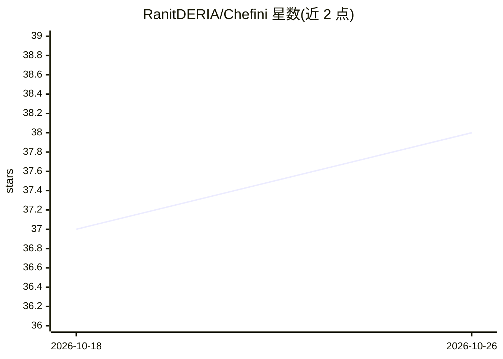

# RanitDERIA/Chefini

⭐ 38 · TypeScript · MIT · 推送 2025-12-17 · [GitHub](https://github.com/RanitDERIA/Chefini) · [官网](https://chefini.vercel.app) · 个人维护

**面向家庭厨师的 AI 烹饪应用：用剩余食材生成菜谱**

基于 Next.js 16 构建的 Web 应用，调用 Groq 的 Llama-3.3-70b-versatile 模型，为家庭厨师提供三类功能：根据现有食材生成菜谱（含素食/非素过滤）、3-5 天批量备餐计划与购物清单、以及分析过咸/过辣等问题的‘风味救援实验室’。另含数字菜谱本、PDF/图片导出、AI 内容审核与 NextAuth 认证，数据存于 MongoDB。需 Node.js 环境自行部署，Groq API 需账号。

## 筛选速览

| 维度 | 判定 | 备注 |
|---|---|---|
| AI 角色 | `ai-native` | 本体是模型或模型工具 |
| 许可风险 | `permissive` | MIT |
| 部署形态 | `library` | 以包/库形式分发 |
| 模型依赖 | locked-api |  |
| 硬件要求 | — | 无带数字的原话,不猜 |
| 安装摩擦 | `low` | 无编译、无系统依赖或容器化 |
| 成熟度 | — | 结构信号不足 |

## 能力要点

- 根据手边食材即时生成定制菜谱
- 批量备餐计划并自动生成购物清单
- 风味救援实验室分析菜品问题并给出烹饪修正
- AI 内容审核过滤无关或冒犯性输入

## 适用场景

- 家里有剩余食材时快速找到可做的菜
- 规划一周备餐并生成购物清单
- 菜品调味失手时寻求补救方法

## 场景标签

 · 领域:食品科技/消费应用

## 证据(README 行号)

> L12:  Chefini is an intelligent culinary companion that turns your leftovers into gourmet meals, plans your weekly batch
> L45: - **AI Engine:** Groq Groq SDK (Llama-3.3-70b-versatile)
> L58: - **🚑 Flavor Rescue Lab:** Too salty? Too spicy? The AI analyzes the problem and provides a chemical/culinary fix.

## 星数曲线

2026-10-18 37 → 2026-10-26 38（+1）

---
*卡片 v1 · prompt 1.4 · 生成 2026-10-25 · 置信度 high · 依据 README sha `ab2223d509ee` · [字段定义](../../DATASET.md)*
