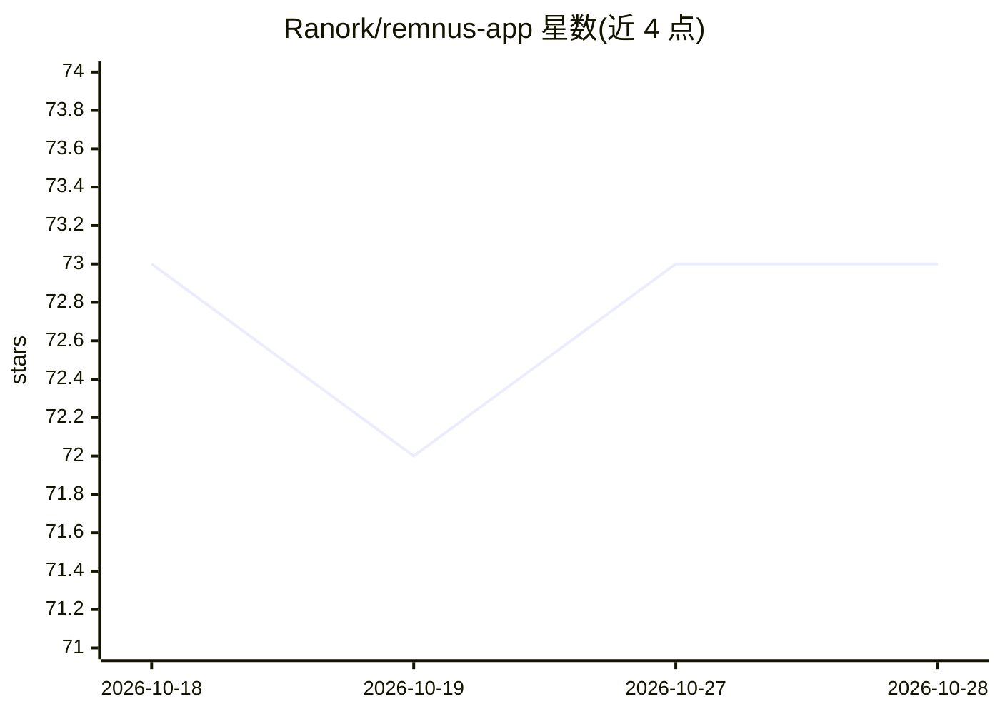

# Ranork/remnus-app

⭐ 73 · TypeScript · AGPL-3.0 · 推送 2026-10-12 · [GitHub](https://github.com/Ranork/remnus-app) · [官网](https://remnus.com) · 个人维护

**人与 AI agent 协作的 MCP 原生工作区：页面/数据库/看板**

开源的自托管工作区应用，提供 Markdown 页面、自定义数据库（表格/看板/日历视图）、仪表盘、多工作区成员与角色权限。其核心设计为 MCP 原生：内置 MCP 服务器（28 工具、7 资源、7 提示词），供 Claude、Cursor 等编辑器与 headless/CI agent 读写工作区内容；编辑器经 OAuth 2.1（PKCE）一键接入，无头 agent 用作用域受限的个人访问令牌。采用 OKF 元数据与 prepare_context 工具生成 token 预算内的 Context Pack v2（BM25 排序）。支持 Docker Compose 部署、Vercel/Railway、Tauri 桌面端与 Capacitor 移动端，AGPL-3.0 许可。

## 筛选速览

| 维度 | 判定 | 备注 |
|---|---|---|
| AI 角色 | `ai-enhanced` | 去掉 AI 部分产品仍成立 |
| 许可风险 | `viral` | AGPL-3.0 |
| 部署形态 | `self-host` | docker 或自建部署 |
| 模型依赖 | — | README 未给出锁定关系 |
| 硬件要求 | — | 无带数字的原话,不猜 |
| 安装摩擦 | `low` | 无编译、无系统依赖或容器化 |
| 成熟度 | — | 结构信号不足 |

## 能力要点

- 内置 MCP 服务器：28 工具 + 7 资源 + 7 提示词（Streamable HTTP）
- 编辑器 OAuth 2.1 (PKCE) 一键接入，CI/headless agent 用作用域令牌
- prepare_context 生成 BM25 排序的 Context Pack v2，Smart/Strict 两种 MCP 策略
- 页面/数据库/看板/日历/仪表盘 + 多工作区角色权限

## 适用场景

- 让 Cursor、Claude Code 等编码 agent 直接读写我的项目知识库
- 团队在页面与数据库中协作，AI agent 通过 MCP 同步维护内容
- CI 流水线用访问令牌无头更新工作区数据

## 场景标签

`知识库管理` · 领域:知识与检索

## 证据(README 行号)

> L5: **Open-source MCP-native workspace for humans and AI agents.**
> L17: Remnus is the Human-Agent Collaborative Workspace, built around the Model Context Protocol (MCP). Every page, datab
> L34: - **MCP Server** — 28 tools + 7 resources + 7 prompts over stateless Streamable HTTP

## 星数曲线

2026-10-18 73 → 2026-10-28 73（+0）

---
*卡片 v1 · prompt 1.4 · 生成 2026-10-24 · 置信度 high · 依据 README sha `a97b28e929fa` · [字段定义](../../DATASET.md)*
