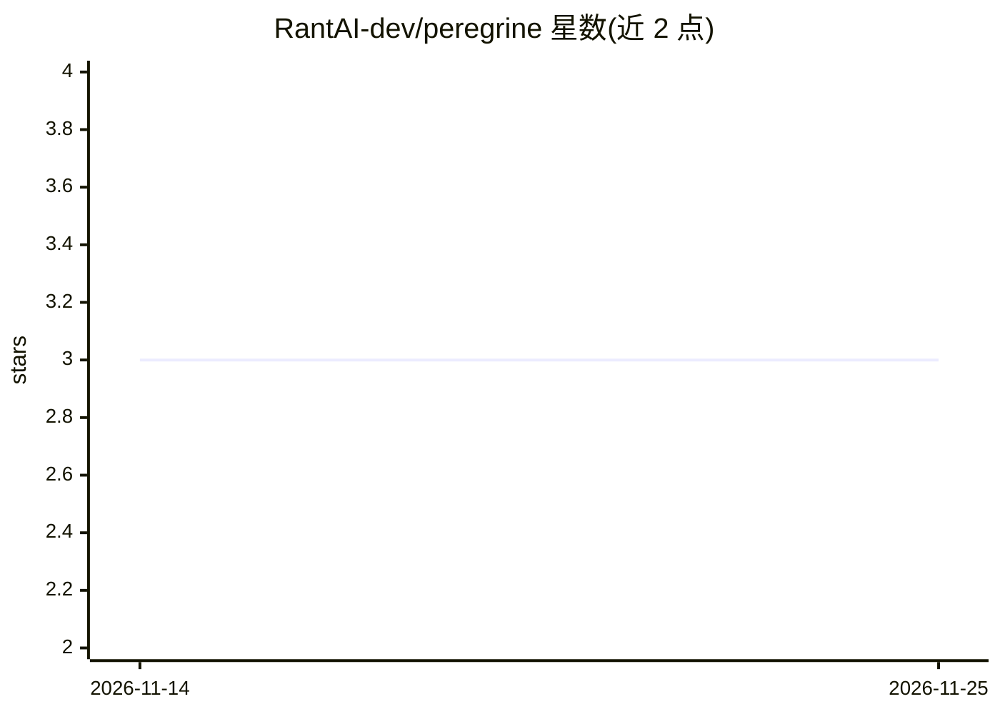

# RantAI-dev/peregrine

⭐ 3 · Rust · Apache-2.0 · 推送 2026-11-20 · [GitHub](https://github.com/RantAI-dev/peregrine) · 组织维护

**面向开发者/终端用户的 CPU 端语言模型推理引擎（Rust/GGUF）**

纯 Rust 编写的 CPU 推理引擎，读取 GGUF 模型并生成文本、 embeddings 与 OpenAI 兼容 API。运行时仅依赖 memmap2，SIMD 指令层（AVX-512/AVX2/NEON/i8mm/scalar）在加载时自动选择，并报告每 token 字节流量以便对照内存带宽核验。支持 hf: 协议从 Hugging Face 下载并缓存模型、`/v1/chat/completions`（含 tool calling 与 JSON schema 约束）、`/v1/embeddings`（Qwen3-Embedding/EmbeddingGemma/BERT/ModernBERT 编码器）与后台服务化部署。工具调用目前仅支持 Qwen 2.5/3/3.5 与 Bonsai 2 聊天模型，其他模型族返回 400。提供 Linux/macOS/Windows 安装脚本与 Docker 镜像构建。

## 筛选速览

| 维度 | 判定 | 备注 |
|---|---|---|
| AI 角色 | `ai-native` | 本体是模型或模型工具 |
| 许可风险 | `permissive` | Apache-2.0 |
| 部署形态 | `desktop` | 安装包/桌面程序 |
| 模型依赖 | — | README 未给出锁定关系 |
| 硬件要求 | — | 无带数字的原话,不猜 |
| 安装摩擦 | `low` | 无编译、无系统依赖或容器化 |
| 成熟度 | — | 结构信号不足 |

## 能力要点

- 纯 Rust、单一运行时依赖（memmap2）读取 GGUF 模型
- 运行时自动选择 SIMD 层（AVX-512/AVX2/NEON/i8mm/scalar）
- 提供 OpenAI 兼容 `/v1/chat/completions`、tool calling 与 `/v1/embeddings`
- hf: 协议下载缓存模型，支持门控/私有仓库的 HF_TOKEN

## 适用场景

- 在无 GPU 的 CPU 机器上本地运行 GGUF 语言模型
- 为应用提供 OpenAI 兼容的本地推理 API 与嵌入服务
- 通过 tool calling 将本地模型接入函数调用工作流
- 对照内存带宽核验推理吞吐数据

## 场景标签

`推理引擎` · 领域:训练与推理

## 证据(README 行号)

> L3: **A CPU inference engine for language models, built to be the fastest on the hardware people already have.**
> L9: Peregrine runs GGUF models on CPUs, in pure Rust with one runtime dependency (`memmap2`). It reports the
> L112: ## Serve the OpenAI API
> L122: The server speaks `/v1/chat/completions` (streamed or not), plus `/v1/models`, `/health` and `/metrics`.

## 星数曲线

2026-11-14 3 → 2026-11-25 3（+0）

---
*卡片 v1 · prompt 1.4 · 生成 2026-11-22 · 置信度 high · 依据 README sha `3620163abd0e` · [字段定义](../../DATASET.md)*
