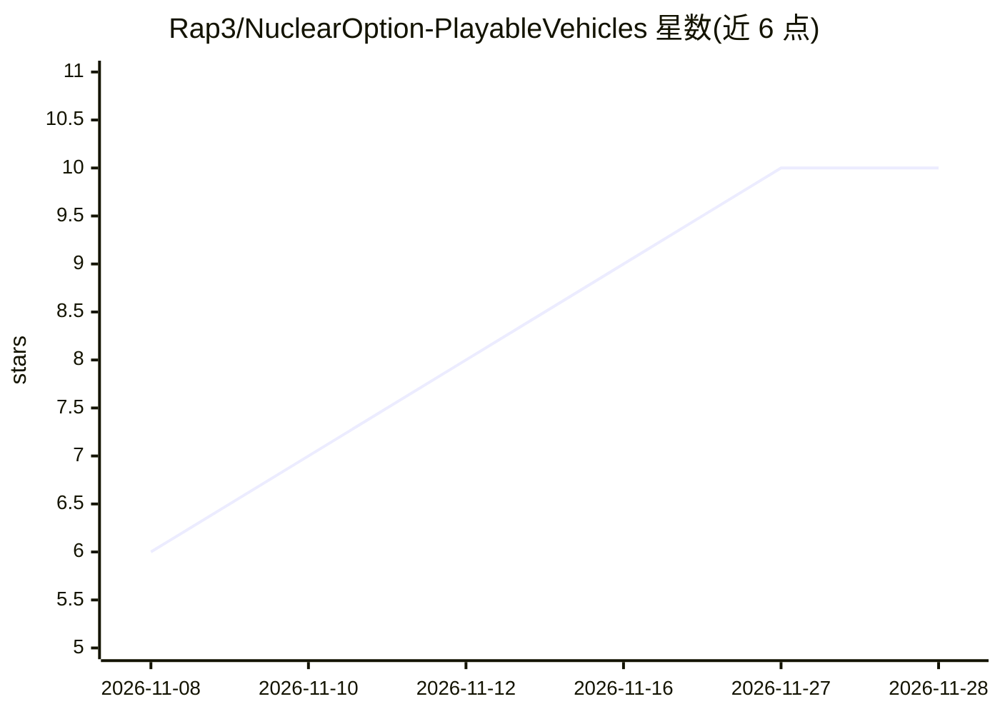

# Rap3/NuclearOption-PlayableVehicles

⭐ 10 · C# · MIT · 推送 2026-11-27 · [GitHub](https://github.com/Rap3/NuclearOption-PlayableVehicles) · 个人维护

**在 Nuclear Option 中驾驶地面载具的游戏模组**

为飞行游戏 Nuclear Option 制作的 BepInEx 模组，让玩家可以购买并驾驶坦克、步兵战车、防空导弹车、火炮、补给卡车等地面载具，支持单人及多人模式。功能包括按游戏内价格买卖载具、分区域装甲与跳弹伤害模型、火控计算机的直射/间射支持、牵引与集装箱运输、补给任务以及占领基地。安装方式为下载 Releases 页的 DLL 放入 BepInEx 插件文件夹。

## 筛选速览

| 维度 | 判定 | 备注 |
|---|---|---|
| AI 角色 | `ai-enhanced` | 去掉 AI 部分产品仍成立 |
| 许可风险 | `permissive` | MIT |
| 部署形态 | `desktop` | 安装包/桌面程序 |
| 模型依赖 | — | README 未给出锁定关系 |
| 硬件要求 | — | 无带数字的原话,不猜 |
| 安装摩擦 | `low` | 无编译、无系统依赖或容器化 |
| 成熟度 | — | 结构信号不足 |

## 能力要点

- 支持在己方仓库/机场按游戏内价格购买与回售地面载具
- 分区装甲模型：正面/侧面/尾部/顶部各自厚度系数、斜面跳弹与内部损伤
- 火控计算机支持直射与间射，弹道与防空导弹均可使用
- 多人模式仅主机端计算伤害，版本不匹配时有提示

## 适用场景

- 在单人任务里驾驶坦克和火炮参战
- 多人服务器中与队友配合组建防空导弹连
- 驾驶补给卡车为缺弹车辆补给赚取报酬

## 场景标签

 · 领域:游戏/模组

## 证据(README 行号)

> L5: Nuclear Option has hundreds of vehicles fighting on the ground, yet you only ever see them from a cockpit. This mod
> L131: The radar/search network itself is the base game's own mechanics, unchanged by the mod — it just becomes visible

## 星数曲线

2026-11-08 6 → 2026-11-28 10（+4）

---
*卡片 v1 · prompt 1.4 · 生成 2026-11-20 · 置信度 mid · 依据 README sha `ae949981ad76` · [字段定义](../../DATASET.md)*
