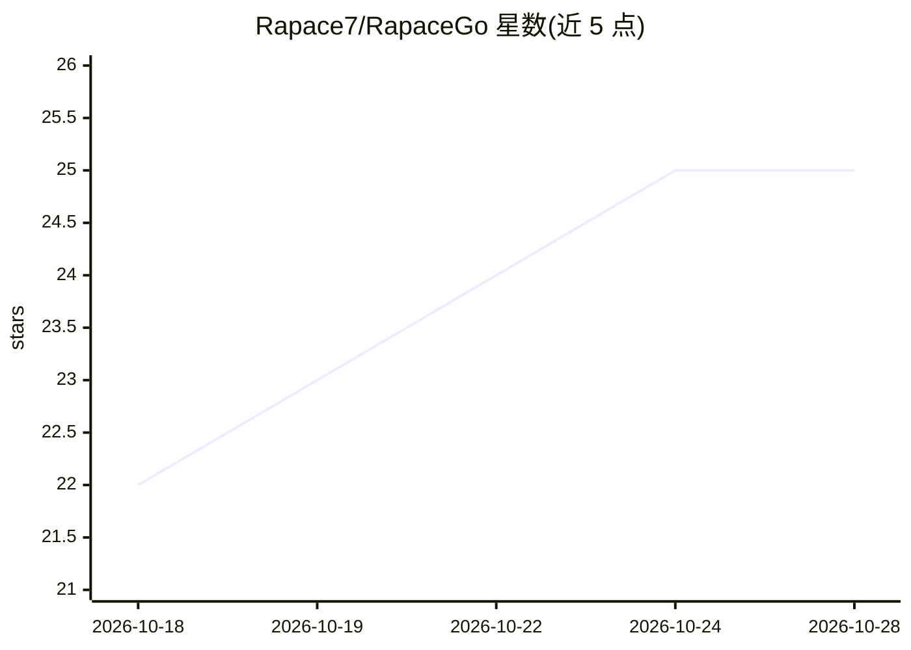

# Rapace7/RapaceGo

⭐ 25 · JavaScript · NOASSERTION · 推送 2026-10-23 · [GitHub](https://github.com/Rapace7/RapaceGo) · 个人维护 · 中文 README

**本地 AI 围棋对弈与复盘讲解的 Windows 桌面工具**

基于 Electron 的围棋桌面应用，面向棋类爱好者：用 KataGo 引擎做人机对弈（20 级-9 段人类棋风）、胜率/目差/推荐点等客观数据与整盘复盘报告；用本地 LoGos-7B 模型经 llama.cpp 生成大白话棋局讲解，好坏判定以 KataGo 胜率涨跌为准而非模型自评。全部引擎在本地运行、不联网不上传棋谱。Windows 提供预编译包，macOS 需自行打包并配置引擎；讲解模型占约 4.9GB 显存，4GB 显存只能用 KataGo 部分。

## 筛选速览

| 维度 | 判定 | 备注 |
|---|---|---|
| AI 角色 | `ai-native` | 本体是模型或模型工具 |
| 许可风险 | `none` | NOASSERTION |
| 部署形态 | `desktop` | 安装包/桌面程序 |
| 模型依赖 | local-ok | 支持本地模型 |
| 硬件要求 | `gpu-8g` | |
| 安装摩擦 | `high` | 编译与系统依赖俱全 |
| 成熟度 | — | 结构信号不足 |

## 能力要点

- KataGo 引擎提供对弈、胜率/目差/推荐点与黑白分开的复盘报告
- LoGos 本地 7B 模型生成结论-道理-对照三段式讲解，数字由 KataGo 提供
- 引擎与模型全部本地运行，不联网、不上传棋谱
- 默认不加载引擎不占显存，支持 N/A/Intel 显卡与纯 CPU 模式

## 适用场景

- 跟人类棋风的 AI 下棋并按段位调难度
- 下完棋后逐手复盘，知道自己哪手错、为什么错
- 导入职业棋谱和题集，配合讲解与解说词编辑研究

## 场景标签

 · 领域:棋类游戏/桌面工具

## 证据(README 行号)

> L3: > 一个 Windows 桌面围棋工具：**跟 AI 下棋、看客观数据、听本地模型用大白话讲棋。**
> L28: |**LoGos**（本地小模型）|讲得清 —— 用大白话讲「这一手为什么好 / 差、当时 AI 想下哪」。|
> L53:  **① 结论**先摆出来（好棋就夸、烂棋就骂）—— 好坏由 **KataGo 的胜率涨跌**说了算，不是让模型自己夸；

## 星数曲线

2026-10-18 22 → 2026-10-28 25（+3）

---
*卡片 v1 · prompt 1.4 · 生成 2026-10-27 · 置信度 mid · 依据 README sha `15bbd02bcb11` · [字段定义](../../DATASET.md)*
