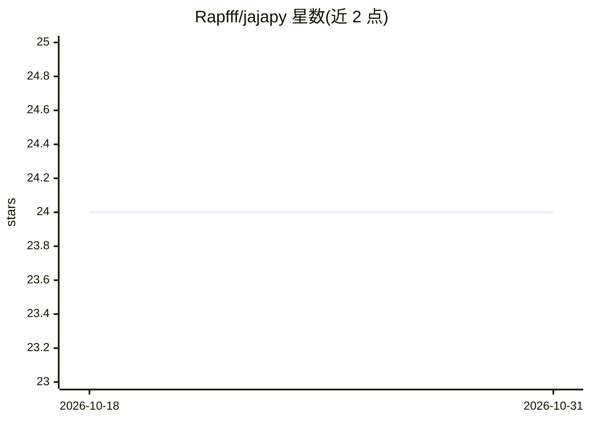

# Rapfff/jajapy

⭐ 24 · Python · MIT · 推送 2026-05-25 · [GitHub](https://github.com/Rapfff/jajapy) · 个人维护

**对多类马尔可夫模型实现 Baum-Welch 学习算法的 Python 库**

Python 库，在 MC、MDP、CTMC、PCTMC、HMM、GoHMM 等多类马尔可夫模型上实现 Baum-Welch 及 Alergia、IOAlergia、Active Baum-Welch 等学习算法，从数据学习模型参数。生成的模型兼容 Stormpy 模型检测器，可作为 Storm 模型检测器的学习扩展；同时兼容 Prism。要求 Python 3.6，依赖 numpy/scipy/sympy 等，stormpy 为推荐可选依赖。工具论文扩展版发表于 QEST'23。

## 筛选速览

| 维度 | 判定 | 备注 |
|---|---|---|
| AI 角色 | `ai-native` | 本体是模型或模型工具 |
| 许可风险 | `permissive` | MIT |
| 部署形态 | `library` | 以包/库形式分发 |
| 模型依赖 | — | README 未给出锁定关系 |
| 硬件要求 | — | 无带数字的原话,不猜 |
| 安装摩擦 | `low` | 无编译、无系统依赖或容器化 |
| 成熟度 | — | 结构信号不足 |

## 能力要点

- 覆盖 MC/MDP/CTMC/PCTMC/HMM/GoHMM 六类模型的 Baum-Welch 实现
- 生成兼容 Stormpy 的模型，可作 Storm 模型检测器的学习扩展
- 另含 Alergia、IOAlergia、Active Baum-Welch 等学习算法

## 适用场景

- 从观测序列学习 HMM 或马尔可夫链模型
- 为 Storm/Prism 模型检测生成可学习得到的模型
- 概率模型学习相关研究并引用（QEST'23 工具论文）

## 场景标签

`科研工具` · 领域:学习与行业

## 证据(README 行号)

> L7: `jajapy` is a python library implementing the **Baum-Welch** algorithm on various kinds of Markov models.
> L16: |MDP|Baum-Welch for MDPs (ref) Active Baum-Welch (ref) IOAlergia (ref)|

## 星数曲线

2026-10-18 24 → 2026-10-31 24（+0）

---
*卡片 v1 · prompt 1.4 · 生成 2026-10-27 · 置信度 high · 依据 README sha `b0f0cce0aca4` · [字段定义](../../DATASET.md)*
