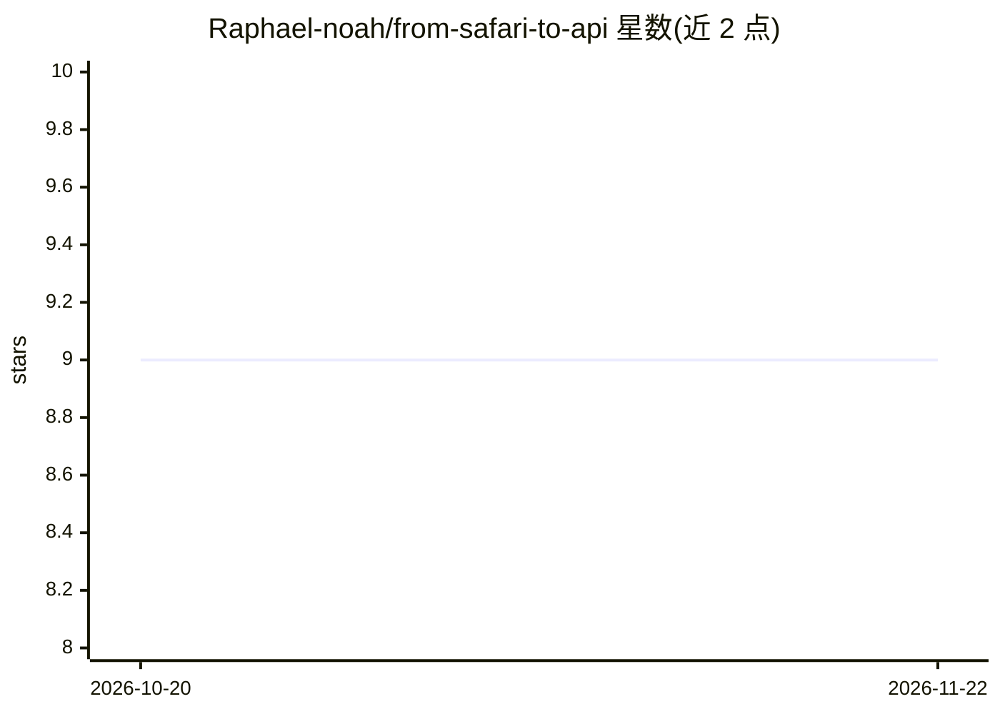

# Raphael-noah/from-safari-to-api

⭐ 9 · Python · MIT · 推送 2026-10-28 · [GitHub](https://github.com/Raphael-noah/from-safari-to-api) · 个人维护 · 中文 README

**把 Safari 网页对话包装成本地 OpenAI/Anthropic 兼容 API 的桥接服务**

在 macOS 上通过 AppleScript 驱动 Safari 当前标签页中的网页对话（如 chat.deepseek.com），把 prompt 注入输入框、轮询结果节点，由 FastAPI 服务将其暴露为本地 HTTP API，提供 /v1/chat/completions 与 /v1/messages 两套协议端点。面向想在 Claude Code / ccswitch 等 agent 工具中复用免费网页对话的用户。限制：仅 macOS + Safari、请求串行排队、无真正流式输出、工具调用靠文本协议模拟且稳定性有限，用户需自行配置目标网页的 CSS 选择器。

## 筛选速览

| 维度 | 判定 | 备注 |
|---|---|---|
| AI 角色 | `ai-ecosystem` | LLM/agent 周边工具 |
| 许可风险 | `permissive` | MIT |
| 部署形态 | `library` | 以包/库形式分发 |
| 模型依赖 | — | README 未给出锁定关系 |
| 硬件要求 | — | 无带数字的原话,不猜 |
| 安装摩擦 | `low` | 无编译、无系统依赖或容器化 |
| 成熟度 | — | 结构信号不足 |

## 能力要点

- 提供 OpenAI Chat Completions 与 Anthropic Messages 两套兼容端点及 SSE 响应
- check.applescript + server.py 双组件架构，通过 stdout 输出协议解耦
- 文本协议模拟工具调用，解析 <tool_call> 与 DeepSeek DSML 两种格式
- 三轮渐进式工具披露（LAZY_TOOLS）减少注入 prompt 长度

## 适用场景

- 让 Claude Code / ccswitch 走本地代理调用 Safari 里的免费网页对话
- 把网页版聊天模型接入现有 agent / 工具链而无需 API key
- 为本地开发环境提供一个 OpenAI/Anthropic 协议的 mock 式端点

## 场景标签

`浏览器自动化` `模型网关` · 领域:Agent 开发

## 证据(README 行号)

> L5: 把 Safari 的网页对话界面（如 chat.deepseek.com）包装成 API（毕竟大多数情况下网站是免费的）。也可接入 Claude Code / ccswitch 等 agent 工具（支持Anthropic Mess
> L79: FastAPI 服务，默认监听 http://127.0.0.1:8000，提供以下端点。所有 Safari 调用由互斥锁串行化（同一时刻只有一个请求能驱动浏览器），路由声明为同步 def 以便运行在线程池中，事件循环不会被阻塞。
> L222: 供 ccswitch / Claude Code 直接接入。支持 stream: false（JSON）与 stream: true（SSE）两种：

## 星数曲线

2026-10-20 9 → 2026-11-22 9（+0）

---
*卡片 v1 · prompt 1.4 · 生成 2026-11-20 · 置信度 high · 依据 README sha `0c86dc6ef603` · [字段定义](../../DATASET.md)*
