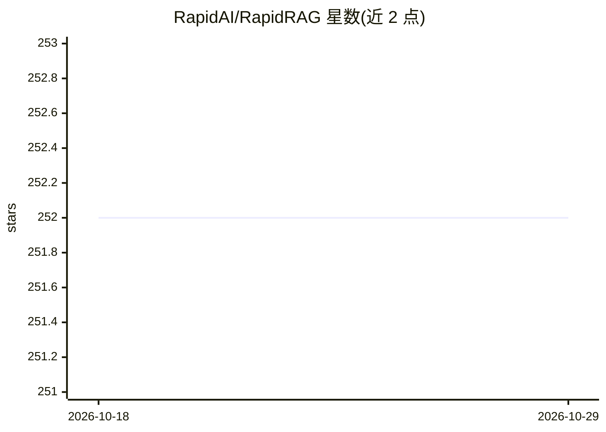

# RapidAI/RapidRAG

⭐ 252 · Python · Apache-2.0 · 推送 2026-01-16 · [GitHub](https://github.com/RapidAI/RapidRAG) · [官网](https://rapidai.github.io/RapidRAG/) · 组织维护 · 中文 README

**基于本地知识库与 LLM 的模块化问答系统**

RapidAI 开源的本地知识库问答项目：用 LLM 对本地文档做问答，支持 txt/md/pdf/docx/pptx/excel 等常见格式并允许自定义扩展。整体模块化设计，不依赖 langchain 库，各组件可替换；除需单独部署的大语言模型接口外，其余部分 CPU 即可运行。灵感来自 Langchain-Chatchat 与文心大模型知识问答实践，文档为中文，计划支持关键词+向量混合检索与 Vue.js UI。当前招募前端工程师以实现前后端分离。

## 筛选速览

| 维度 | 判定 | 备注 |
|---|---|---|
| AI 角色 | `ai-native` | 本体是模型或模型工具 |
| 许可风险 | `permissive` | Apache-2.0 |
| 部署形态 | `None` |  |
| 模型依赖 | — | README 未给出锁定关系 |
| 硬件要求 | — | 无带数字的原话,不猜 |
| 安装摩擦 | `low` | 无编译、无系统依赖或容器化 |
| 成熟度 | — | 结构信号不足 |

## 能力要点

- 本地知识库 + LLM 问答，支持 txt/md/pdf/docx/pptx/excel 等格式
- 模块化设计，不依赖 langchain 库，各组件可替换
- 除 LLM 接口需单独部署外，其余部分可运行于 CPU
- 提供基于 ERNIE Bot 的在线 Demo（需百度账号）

## 适用场景

- 在本地知识文档上搭建问答系统
- CPU 环境下部署轻量 RAG 问答
- 替换或定制 RAG 各环节组件做实验

## 场景标签

`文档问答` `RAG` · 领域:知识与检索

## 证据(README 行号)

> L15: - Questions & Answers based on local knowledge base + LLM.
> L22:  - In addition to the large language model interface that needs to be deployed separately, other parts can use CPU.

## 星数曲线

2026-10-18 252 → 2026-10-29 252（+0）

---
*卡片 v1 · prompt 1.4 · 生成 2026-10-22 · 置信度 high · 依据 README sha `d877993114be` · [字段定义](../../DATASET.md)*
