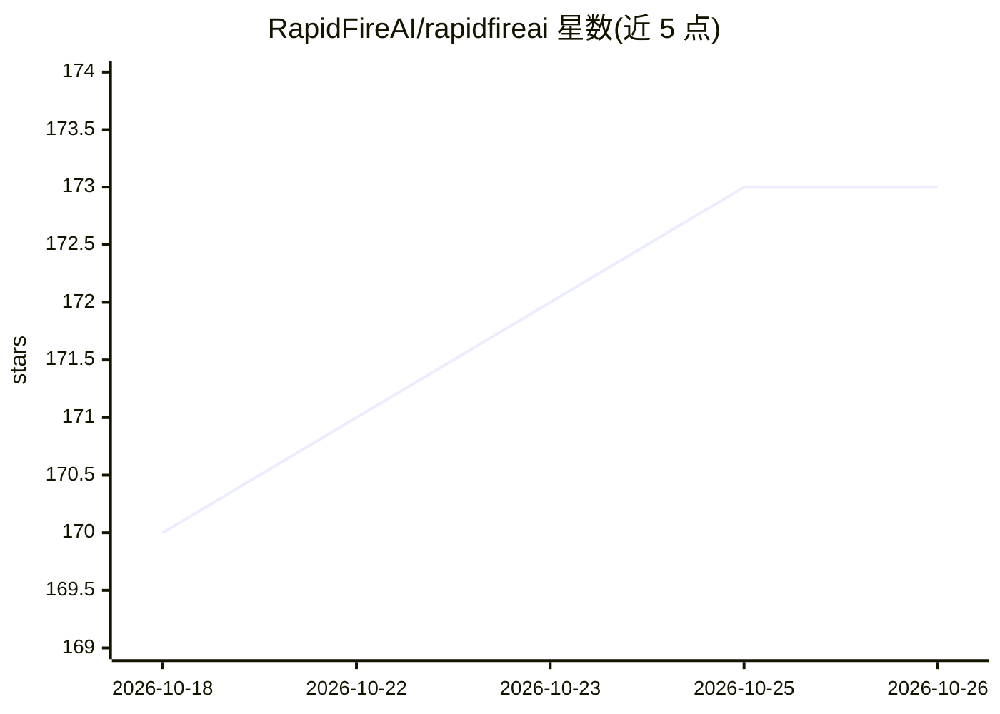

# RapidFireAI/rapidfireai

⭐ 173 · JavaScript · Apache-2.0 · 推送 2026-10-23 · [GitHub](https://github.com/RapidFireAI/rapidfireai) · [官网](https://rapidfire.ai) · 组织维护

**面向 LLM/DL 的快速实验执行框架：从 RAG 评测到微调**

实验执行框架，用于 LLM 与其他深度学习模型的 RAG/上下文工程评测（mode=evals）与微调/后训练（mode=fit）。采用微服务式架构：Dispatcher（REST API）、SQLite 数据库、Controller（用户进程内编排）、GPU Worker 与 MLflow fork 仪表盘。提供分片级超并行执行与实时交互控制（停止/恢复/克隆修改运行）、多 GPU 调度、Grid/Random 搜索。要求 Python 3.12、NVIDIA GPU（7.x/8.x 计算能力）、CUDA 11.8+、PyTorch 2.8.0+；支持 CPU-only 机器配合闭源模型 API 使用。

## 筛选速览

| 维度 | 判定 | 备注 |
|---|---|---|
| AI 角色 | `ai-ecosystem` | LLM/agent 周边工具 |
| 许可风险 | `permissive` | Apache-2.0 |
| 部署形态 | `library` | 以包/库形式分发 |
| 模型依赖 | — | README 未给出锁定关系 |
| 硬件要求 | `cpu-ok` | |
| 安装摩擦 | `medium` | 含编译或系统依赖之一 |
| 成熟度 | — | 结构信号不足 |

## 能力要点

- 分片级超并行执行，单 GPU 或 CPU-only 机器可并发比较多组配置
- IC Ops 实时交互控制：Stop/Resume/Clone-Modify/暖启动运行中任务
- 全量 MLflow 集成与 fork 版 MLflow 仪表盘做实验跟踪
- 内置 Grid Search 与 Random Search 配置搜索，多 GPU 自动调度

## 适用场景

- 并发对比多组 RAG 配置的检索/重排/生成效果
- 批量运行 SFT/DPO 等微调实验并实时暂停、恢复、克隆修改
- 在多 GPU 机器上编排微调实验并跟踪指标

## 场景标签

`模型评测` `微调` `MLOps` · 领域:评测与运维

## 证据(README 行号)

> L17: Built for agentic RAG, context engineering, fine-tuning, and post-training of LLMs and other DL models.
> L30: RapidFire AI is a new experiment execution framework that transforms your AI customization experimentation from slo

## 星数曲线

2026-10-18 170 → 2026-10-26 173（+3）

---
*卡片 v1 · prompt 1.4 · 生成 2026-10-22 · 置信度 high · 依据 README sha `94ae7c5359bf` · [字段定义](../../DATASET.md)*
