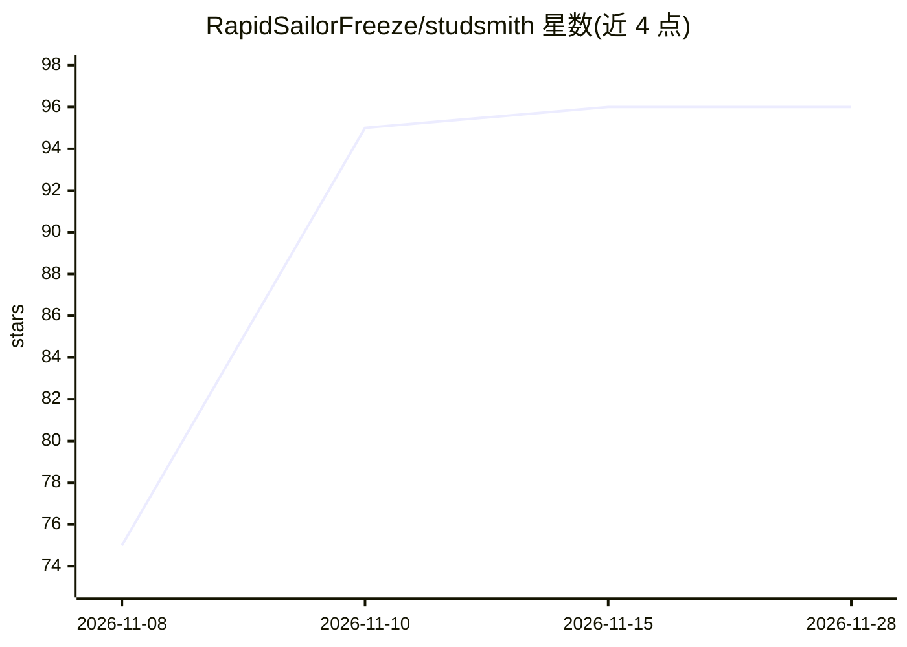

# RapidSailorFreeze/studsmith

⭐ 96 · 推送 2026-11-13 · [GitHub](https://github.com/RapidSailorFreeze/studsmith) · 个人维护 · 中文 README

**Windows 端 Roblox Studio AI 智能体，用自然语言写 Luau 代码**

面向 Roblox 游戏开发者的免费 Windows 桌面应用：以自然语言描述需求，agent 生成计划与 Luau 脚本、在游戏中创建组织对象，并以 diff 形式展示每处改动，应用前可审查；支持撤销单个改动或整个任务（还原点）。内置 playtest 循环：运行游戏、读取报错并自行修复。可使用本地模型或自有 API key。安装为下载 zip 解压运行 exe，需 Windows 10/11 64 位；未代码签名会触发 SmartScreen 警告，发布说明提供 SHA-256 校验。项目声明与 Roblox Corporation 无隶属关系。

## 筛选速览

| 维度 | 判定 | 备注 |
|---|---|---|
| AI 角色 | `ai-native` | 本体是模型或模型工具 |
| 许可风险 | `none` | — |
| 部署形态 | `desktop` | 安装包/桌面程序 |
| 模型依赖 | — | README 未给出锁定关系 |
| 硬件要求 | — | 无带数字的原话,不猜 |
| 安装摩擦 | `low` | 无编译、无系统依赖或容器化 |
| 成熟度 | — | 结构信号不足 |

## 能力要点

- 自然语言→计划→Luau 代码的 agent 工作流
- 改动以 diff 形式审查后应用，含还原点撤销
- playtest 循环自动运行游戏、读取报错并修复
- 支持本地模型或自有 API key

## 适用场景

- 用自然语言让 AI 编写和修改 Roblox 游戏脚本
- 让 agent 自动试玩游戏并根据报错自我修复
- 审查并管理 AI 对游戏工程的所有改动

## 场景标签

`编码 Agent` · 领域:编码与开发

## 证据(README 行号)

> L9: ### The AI agent for Roblox Studio.
> L11: Studsmith is a free Windows app that helps you build Roblox games faster. Describe what you want in plain language,

## 星数曲线

2026-11-08 75 → 2026-11-28 96（+21）

---
*卡片 v1 · prompt 1.4 · 生成 2026-11-17 · 置信度 high · 依据 README sha `0df2a70c54a1` · [字段定义](../../DATASET.md)*
