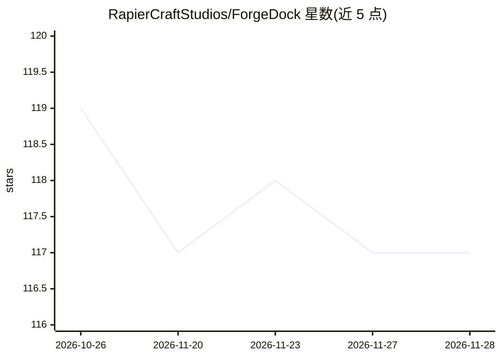

# RapierCraftStudios/ForgeDock

⭐ 117 · JavaScript · AGPL-3.0 · 推送 2026-11-27 · [GitHub](https://github.com/RapierCraftStudios/ForgeDock) · [官网](https://rapiercraftstudios.github.io/ForgeDock/) · 组织维护

**把 GitHub issue 变成已合并 PR 的自主 AI 开发流水线**

ForgeDock 以 CLI 形式编排 AI 编码 agent，将每个 GitHub issue 送入固定流水线：验证、冻结契约的计划、隔离工作树实现、独立审查、PR/CI/合并，多车道并行并按依赖关系调度批次。状态以结构化评论记录在 GitHub issue 上，作为可审计的记忆，崩溃后可恢复；机械性失败（CI 红、合并冲突）自动重试，产品决策、支出与发布始终升级给人。运行依赖用户的 Claude Code 订阅或 ANTHROPIC_API_KEY，仅支持 GitHub 作为 forge。核心 AGPL-3.0，另有商业许可。

## 筛选速览

| 维度 | 判定 | 备注 |
|---|---|---|
| AI 角色 | `ai-ecosystem` | LLM/agent 周边工具 |
| 许可风险 | `dual` | AGPL-3.0 |
| 部署形态 | `library` | 以包/库形式分发 |
| 模型依赖 | locked-api |  |
| 硬件要求 | — | 无带数字的原话,不猜 |
| 安装摩擦 | `low` | 无编译、无系统依赖或容器化 |
| 成熟度 | — | 结构信号不足 |

## 能力要点

- issue→验证→计划（冻结契约）→实现→审查→PR→CI→合并的固定流水线
- 状态记录在 GitHub issue 与崩溃安全运行日志中，重启可恢复且车道互不重复
- 多车道并行批次调度，读取 Depends-on 依赖边
- 发布前需多领域审查面板（安全、并发、auth 等）在 staging 发出 gate 标记

## 适用场景

- 提交一批带依赖关系的 issue，让流水线按序实现并合并 PR
- 在发布前用独立审查与契约门禁拦截回归与安全问题
- 用 forgedock stats 查看 $/merge、重试原因等效率数据

## 场景标签

`编码 Agent` `代码审查` · 领域:编码与开发

## 证据(README 行号)

> L9:  ForgeDock runs AI coding agents through validation, implementation, review, CI and merge, one issue per lane, many 
> L33: ForgeDock orchestrates delivery. It does not replace the model: it runs on your Claude Code account and resells no 
> L113: |Runtime|Claude Code (CLI or subscription). OpenCode is supported with documented parity limits.|

## 星数曲线

2026-10-26 119 → 2026-11-28 117（-2）

---
*卡片 v1 · prompt 1.4 · 生成 2026-11-28 · 置信度 high · 依据 README sha `8209e78bd570` · [字段定义](../../DATASET.md)*
