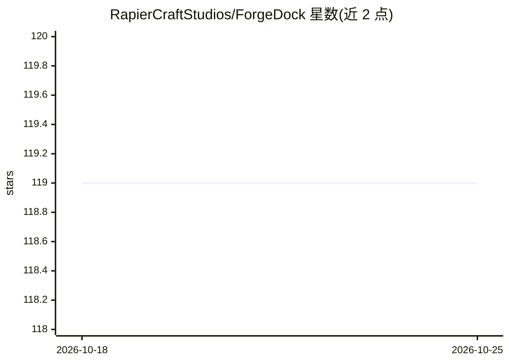

# RapierCraftStudios/ForgeDock

⭐ 119 · JavaScript · AGPL-3.0 · 推送 2026-10-24 · [GitHub](https://github.com/RapierCraftStudios/ForgeDock) · [官网](https://rapiercraftstudios.github.io/ForgeDock/) · 组织维护

**面向 Claude Code 的自主开发流水线：issue 进、合并 PR 出**

在 Claude Code 之上运行的自主软件工程编排工具：把 GitHub 作为 agent 记忆与状态库，`/work-on` 将单个 issue 走完 investigate→context→architect→build→quality gate→review→merge 流水线，`/orchestrate` 用五层冲突检测（含 git 历史共变挖掘）做并行里程碑调度。每阶段以 HTML 注释形式的机器可读标注写回 issue/PR，供下游 agent 读取；执行引擎为事件溯源、崩溃可恢复的规则状态机。审查由 9 个领域专家 agent 执行并带复现门槛。需要 Claude Code（订阅或 ANTHROPIC_API_KEY）、GitHub CLI 与 Node.js ≥ 18。AGPL-3.0 许可。

## 筛选速览

| 维度 | 判定 | 备注 |
|---|---|---|
| AI 角色 | `ai-ecosystem` | LLM/agent 周边工具 |
| 许可风险 | `dual` | AGPL-3.0 |
| 部署形态 | `library` | 以包/库形式分发 |
| 模型依赖 | locked-api |  |
| 硬件要求 | — | 无带数字的原话,不猜 |
| 安装摩擦 | `low` | 无编译、无系统依赖或容器化 |
| 成熟度 | — | 结构信号不足 |

## 能力要点

- GitHub 作为 agent 记忆：每阶段读写机器可读 FORGE 标注
- `/orchestrate` 里程碑级并行调度，五层冲突检测与拓扑排序
- 事件溯源、崩溃安全的执行引擎，GitHub 为权威状态
- 9 个领域专家审查 agent，带置信度与复现门槛

## 适用场景

- 把 GitHub issue 自动驱动到调查、构建、审查、合并的完整 PR
- 并行处理整个里程碑的多 issue 并自动调度冲突
- 让 AI 编码 agent 跨会话保留项目上下文与历史教训

## 场景标签

`编码 Agent` `代码审查` `Agent 记忆` · 领域:Agent 开发

## 证据(README 行号)

> L7:  LLMs generate the code. ForgeDock owns everything else — state, scheduling, recovery, review, and memory — as durab
> L42: **Requires for this demo:** Claude Code (subscription or `ANTHROPIC_API_KEY`) · GitHub CLI (authenticated) · Node.j

## 星数曲线

2026-10-18 119 → 2026-10-25 119（+0）

---
*卡片 v1 · prompt 1.4 · 生成 2026-10-23 · 置信度 high · 依据 README sha `7a000f74b108` · [字段定义](../../DATASET.md)*
