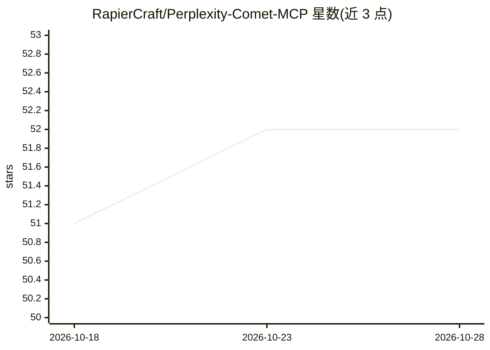

# RapierCraft/Perplexity-Comet-MCP

⭐ 53 · TypeScript · MIT · 推送 2026-06-22 · [GitHub](https://github.com/RapierCraft/Perplexity-Comet-MCP) · 个人维护

**连接 Claude Code 与 Perplexity Comet 浏览器的 MCP 服务器**

hanzili/comet-mcp 的增强分支：以 MCP 服务器形式桥接 Claude Code 与 Perplexity Comet 浏览器，通过 Chrome DevTools Protocol 实现自主网页浏览、多标签管理与代理式研究。提供 8 个工具（comet_connect/ask/poll/stop/screenshot/tabs/mode/upload），支持 Windows/WSL/macOS。相比原版新增 Windows 支持、基于稳定性的完成检测、指数退避自动重连、末位标签保护等。需 Node.js 18+、已安装 Comet 浏览器及 Claude Code 或兼容 MCP 客户端，npm 全局安装或源码构建。

## 筛选速览

| 维度 | 判定 | 备注 |
|---|---|---|
| AI 角色 | `ai-ecosystem` | LLM/agent 周边工具 |
| 许可风险 | `permissive` | MIT |
| 部署形态 | `desktop` | 安装包/桌面程序 |
| 模型依赖 | — | README 未给出锁定关系 |
| 硬件要求 | — | 无带数字的原话,不猜 |
| 安装摩擦 | `low` | 无编译、无系统依赖或容器化 |
| 成熟度 | — | 结构信号不足 |

## 能力要点

- 8 个 MCP 工具：连接、提问、轮询、截图、标签管理、模式切换、文件上传等
- 基于稳定性而非固定超时的完成检测与自动重连
- Windows/WSL/macOS 平台支持及 WSL mirrored networking 配置说明
- 末位外部标签保护与内部标签自动过滤

## 适用场景

- 在 Claude Code 编码时让 Comet 浏览器自主浏览和提取网页数据
- 通过 comet_ask 做深度研究查询，切换 search/research/labs/learn 模式
- 多标签工作流中跟踪、切换与关闭浏览器标签

## 场景标签

`浏览器自动化` · 领域:效率与自动化

## 证据(README 行号)

> L10: A production-grade MCP (Model Context Protocol) server that bridges Claude Code with Perplexity's Comet browser for
> L79: Add to your Claude Code MCP settings (`~/.claude/settings.json` or VS Code settings):
> L257: |`index.ts`|MCP server and tool handlers|

## 星数曲线

2026-10-18 51 → 2026-10-28 52（+1）

---
*卡片 v1 · prompt 1.4 · 生成 2026-10-24 · 置信度 high · 依据 README sha `d98650885ac5` · [字段定义](../../DATASET.md)*
