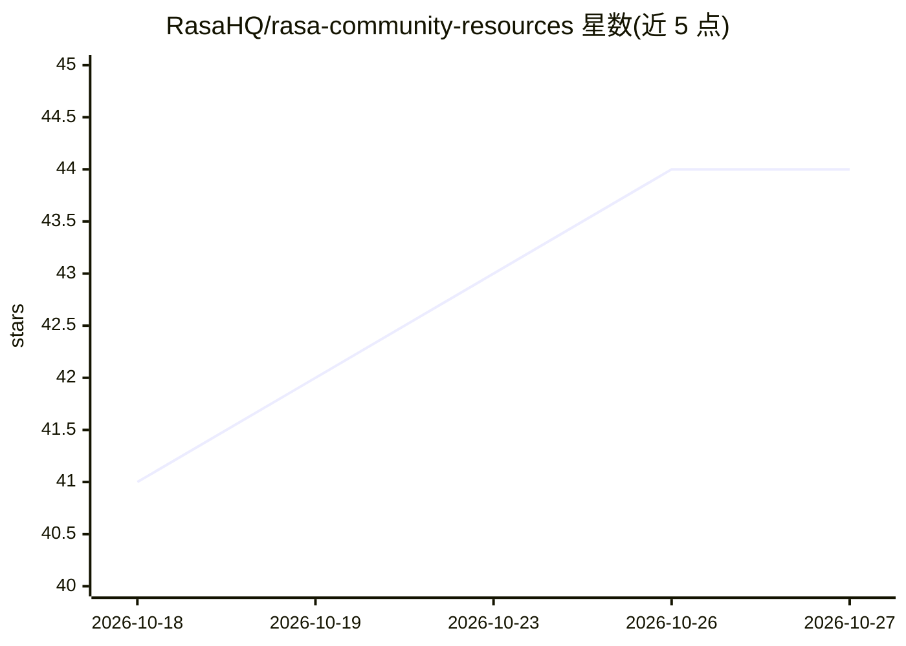

# RasaHQ/rasa-community-resources

⭐ 44 · Python · Apache-2.0 · 推送 2026-10-26 · [GitHub](https://github.com/RasaHQ/rasa-community-resources) · [官网](https://rasa.community/) · 组织维护

**Rasa agent 开发者的教程、示例项目与参考代码合集**

rasa.community 的代码配套仓库：收录可完整运行的教程、克隆即用的成品 agent（语音旅游/银行/电信/保险等场景）、可复用模式（如 ASR/TTS 多厂商 failover 路由）与工作坊材料。资源按维护目录与冻结快照两级组织，每个目录声明作者、核验日期与验证版本；维护目录统一 pin 同一 Rasa Pro 版本，用 make 系列命令校验与迁移。运行需要 RASA_LICENSE（开发者版免费）与 LLM/语音厂商 key。

## 筛选速览

| 维度 | 判定 | 备注 |
|---|---|---|
| AI 角色 | `ai-knowledge` | 知识聚合/清单类 |
| 许可风险 | `permissive` | Apache-2.0 |
| 部署形态 | `library` | 以包/库形式分发 |
| 模型依赖 | — | README 未给出锁定关系 |
| 硬件要求 | — | 无带数字的原话,不猜 |
| 安装摩擦 | `medium` | 含编译或系统依赖之一 |
| 成熟度 | — | 结构信号不足 |

## 能力要点

- 教程/示例/模式/工作坊四类资源，每项附作者与核验日期
- 语音 vendor router 支持 Deepgram/Speechmatics/Rime/faster-whisper 等多厂商 ASR/TTS failover
- make validate/ci/migrate 等命令校验目录一致性与版本迁移
- 维护目录统一 pin Rasa Pro 版本，冻结快照保留作者验证版本

## 适用场景

- 学习并克隆运行 Rasa 语音 agent 成品
- 查找工具设计、评测、人机交接等常见问题的参考实现
- 参加 Software Factacles 工作坊并复现课堂 agent

## 场景标签

`教程课程` · 领域:学习与行业

## 证据(README 行号)

> L3: **Tutorials, example projects, and reference code for practitioners building and operating agents with Rasa.**
> L34: - **Tutorials** — end-to-end walkthroughs, each self-contained, each runnable

## 星数曲线

2026-10-18 41 → 2026-10-27 44（+3）

---
*卡片 v1 · prompt 1.4 · 生成 2026-10-25 · 置信度 mid · 依据 README sha `819edbcfb95b` · [字段定义](../../DATASET.md)*
