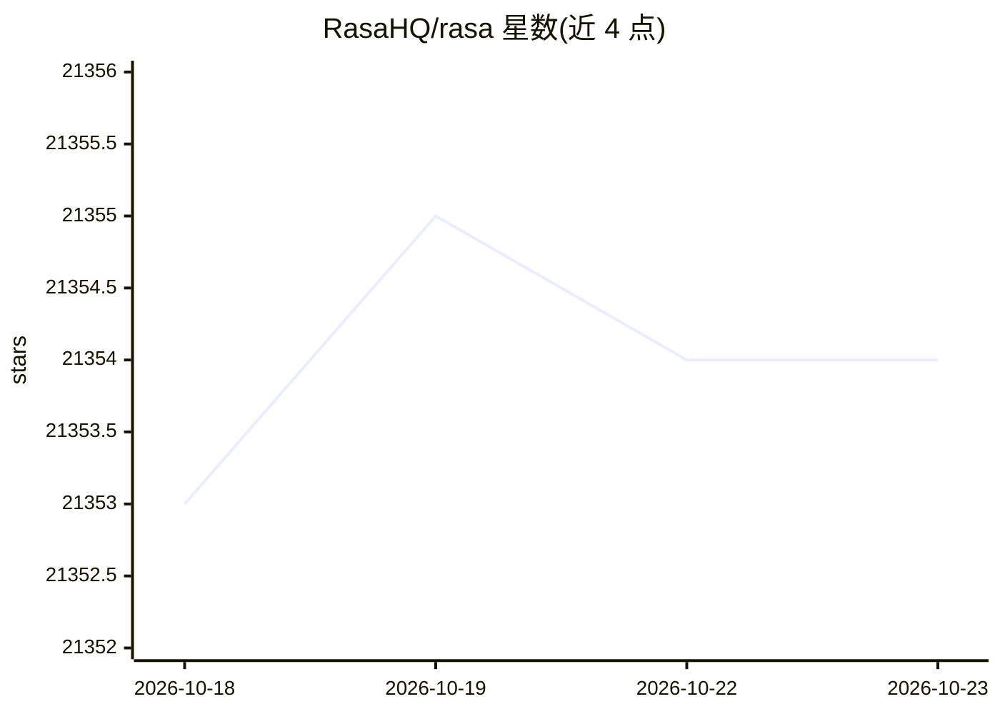

# RasaHQ/rasa

⭐ 21,354 · Python · Apache-2.0 · 推送 2026-07-24 · [GitHub](https://github.com/RasaHQ/rasa) · [官网](https://rasa.com/docs/rasa/) · 组织维护

**构建文本/语音对话助手的开源机器学习框架**

Rasa Open Source 是用于自动化文本与语音对话的开源机器学习框架，支持 NLU 与对话管理，可接入 Facebook Messenger、Slack、Telegram、Twilio 等多种对话渠道构建上下文助手。README 声明该项目当前处于维护模式，开发重心转向基于 CALM 引擎的 Hello Rasa（LLM 处理对话理解、业务流以 Flows 描述、带 Inspector 实时决策查看）。开发者安装走 PyPI，源码开发使用 Poetry 管理依赖，项目采用 Apache 2.0 许可证。

## 筛选速览

| 维度 | 判定 | 备注 |
|---|---|---|
| AI 角色 | `ai-native` | 本体是模型或模型工具 |
| 许可风险 | `permissive` | Apache-2.0 |
| 部署形态 | `library` | 以包/库形式分发 |
| 模型依赖 | — | README 未给出锁定关系 |
| 硬件要求 | — | 无带数字的原话,不猜 |
| 安装摩擦 | `medium` | 含编译或系统依赖之一 |
| 成熟度 | — | 结构信号不足 |

## 动量与使用信号

- 维护:`active` — 距上次 push 86.0 天,年发版 0,298 位贡献者
- 涨星:近 1 天 **+3**(自 20261016 起算)
- 平台:MACOS · 协议:—

## 能力要点

- 支持 NLU 与对话管理，可连接 Slack、Facebook、Telegram、Twilio 等渠道
- 新方向 CALM/Hello Rasa：LLM 理解对话、代码强制业务规则
- Flows 以逻辑步骤而非对话树描述业务流程
- 源码开发使用 Poetry 与 make 构建

## 适用场景

- 构建接入多渠道的文本/语音客服或对话助手
- 在浏览器 playground 中用模板原型化 AI agent
- 维护基于经典 Rasa 框架的存量对话系统

## 场景标签

`Agent 框架` · 领域:Agent 开发

## 证据(README 行号)

> L62: Rasa is an open source machine learning framework for automating text and voice-based conversations. With Rasa, you
> L12:  Rasa Open Source is currently in maintenance mode.
> L22: **Hello Rasa** is our new interactive playground for prototyping AI agents. It combines LLM fluency with the reliab

## 星数曲线

2026-10-18 21,353 → 2026-10-23 21,354（+1）

---
*卡片 v1 · prompt 1.4 · 生成 2026-10-18 · 置信度 high · 依据 README sha `ed03567071f5` · [字段定义](../../DATASET.md)*
