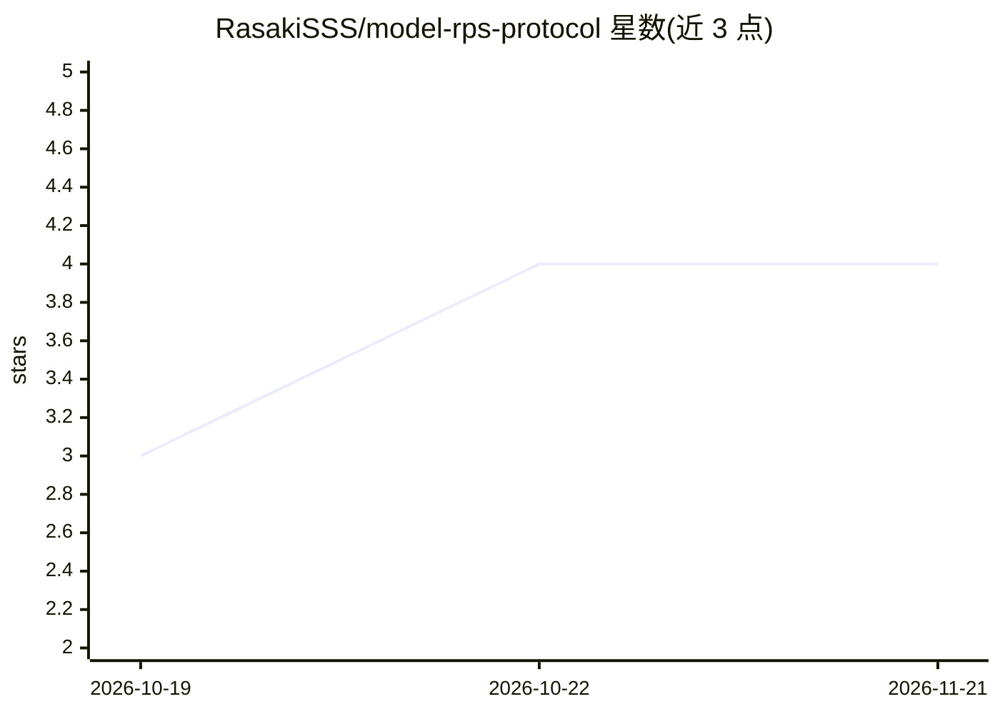

# RasakiSSS/model-rps-protocol

⭐ 4 · Python · MIT · 推送 2026-10-21 · [GitHub](https://github.com/RasakiSSS/model-rps-protocol) · 个人维护 · 中文 README

**命令行工具：人类与大模型玩石头剪刀布并赛后聊天**

基于 Python 的命令行对局程序，支持人类对人类、人类对大语言模型、两个独立模型对模型的石头剪刀布比赛，赛后双方沿用各自上下文继续聊天。裁判逻辑由本地 Python 实现，负责规则、信息隔离和胜负判定，不依赖模型自身守规。支持 BO 任意正奇数、同时或轮流行动、锁定/改拳模式、局中模型接管、共享房间双终端对战，以及外部 Agent 经 MCP 入场。已接入 OpenAI、DeepSeek、GLM、Gemini、Grok、Claude 的参数方案。发布包为源码，需 Python 3.12+ 并自行安装依赖。

## 筛选速览

| 维度 | 判定 | 备注 |
|---|---|---|
| AI 角色 | `ai-native` | 本体是模型或模型工具 |
| 许可风险 | `permissive` | MIT |
| 部署形态 | `desktop` | 安装包/桌面程序 |
| 模型依赖 | locked-api |  |
| 硬件要求 | — | 无带数字的原话,不猜 |
| 安装摩擦 | `low` | 无编译、无系统依赖或容器化 |
| 成熟度 | — | 结构信号不足 |

## 能力要点

- Python 裁判负责规则、信息隔离与胜负判定，模型不担任裁判
- 支持人类/模型任意组合对战，赛后沿用上下文继续聊天
- v1.1.0 提供本机共享房间、人类双终端与 MCP 外部 Agent 入口
- 离线演示模式无需配置或 API 密钥

## 适用场景

- 观察大模型在带聊天的博弈中的行为
- 组织两个模型按可配置规则进行石头剪刀布比赛
- 本地搭建人类与 LLM 的对局娱乐

## 场景标签

`聊天机器人` · 领域:对话与助手

## 证据(README 行号)

> L9: 让人类与人类、人类与大语言模型，或两个独立的模型，在命令行中聊天、等待和出拳。Python 裁判负责规则、信息隔离和胜负判定；比赛结束后，双方沿用各自上下文继续聊天。
> L11: 支持任意正奇数 BO、Red / Blue 席位、同模型对战、人类玩家、独立聊天、同时或轮流行动、局中模型接管，以及比赛之间换人。已接入 OpenAI、DeepSeek、GLM、Gemini、Grok 和 Claude 的参数方案
> L94: |`model-rps-mcp`|MCP stdio 服务，由宿主启动，见 MCP 接入|

## 星数曲线

2026-10-19 3 → 2026-11-21 4（+1）

---
*卡片 v1 · prompt 1.4 · 生成 2026-11-21 · 置信度 mid · 依据 README sha `6a261df33def` · [字段定义](../../DATASET.md)*
