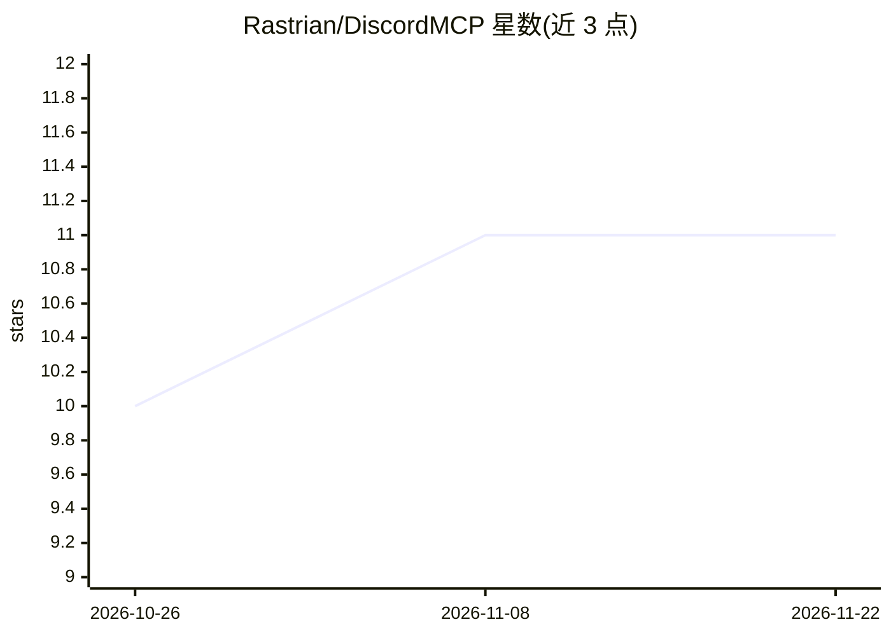

# Rastrian/DiscordMCP

⭐ 11 · Python · Apache-2.0 · 推送 2026-11-07 · [GitHub](https://github.com/Rastrian/DiscordMCP) · [官网](https://blog.rastrian.dev/post/discordmcp-controlling-servers-through-mcp) · 个人维护

**把 Discord 操作暴露为 MCP 工具的多服务器控制平面**

多服务器 Discord 控制平面：用户通过 OAuth2 连接 Discord 身份、安装平台机器人，即可由 MCP 兼容 AI 客户端或在 Discord 内 @机器人以自然语言执行服务器管理操作。提供 70 个 MCP 工具（覆盖频道、消息、角色、成员、Webhook、邀请、Automod 等域），变更类工具默认 dry-run、风险操作需确认、写入全部审计。内置响应 @mention 的对话式 Agent（约 60 个工具、按频道历史、按用户冷却）。基于 FastAPI + PostgreSQL + Redis，Docker Compose 部署，仅 linux/amd64 镜像。

## 筛选速览

| 维度 | 判定 | 备注 |
|---|---|---|
| AI 角色 | `ai-ecosystem` | LLM/agent 周边工具 |
| 许可风险 | `permissive` | Apache-2.0 |
| 部署形态 | `self-host` | docker 或自建部署 |
| 模型依赖 | — | README 未给出锁定关系 |
| 硬件要求 | — | 无带数字的原话,不猜 |
| 安装摩擦 | `low` | 无编译、无系统依赖或容器化 |
| 成熟度 | — | 结构信号不足 |

## 能力要点

- 70 个 MCP 工具覆盖 Guild/Channel/Message/Role/Member/Webhook/Automod 等 15 个域
- 变更类工具默认 dry-run，风险操作需显式确认，全部写入有审计日志
- 内置对话式 Agent：约 60 个工具、按频道会话历史、按用户冷却、/allow-chat 管控
- 基于官方 Discord OpenAPI spec 做端点覆盖率回归检查与定时同步 PR

## 适用场景

- 用 MCP 客户端以自然语言管理多个 Discord 服务器的频道、角色与成员
- 在 Discord 内 @机器人执行消息摘要、建频道、公告等操作
- 为 #support 频道创建 FAQ 自动应答等自动化流程
- 通过 dry-run 与审计日志安全地委托高风险管理操作

## 场景标签

`工作流自动化` · 领域:效率与自动化

## 证据(README 行号)

> L3: A multi-server Discord control plane that exposes Discord operations as MCP tools, resources, and prompts for AI cli
> L39: ### MCP Server (70 tools)
> L39: ### MCP Server (70 tools)
> L201: HTTP mode: the MCP server is available at `http://localhost:8000/mcp` when `MCP_TRANSPORT=http`.

## 星数曲线

2026-10-26 10 → 2026-11-22 11（+1）

---
*卡片 v1 · prompt 1.4 · 生成 2026-11-18 · 置信度 high · 依据 README sha `befb50729ef4` · [字段定义](../../DATASET.md)*
