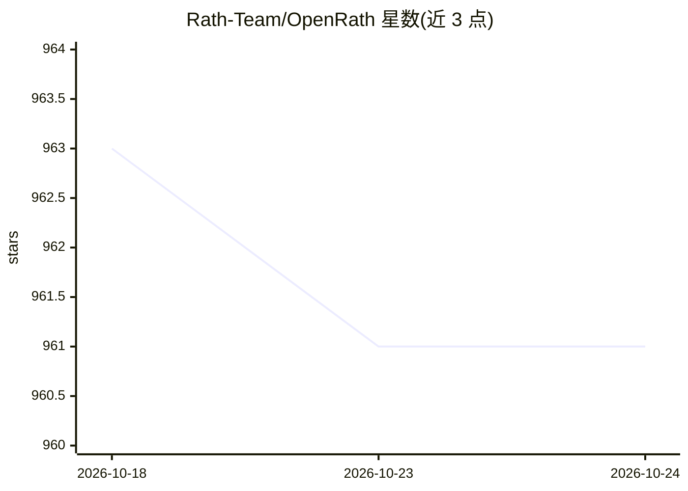

# Rath-Team/OpenRath

⭐ 961 · Python · BSD-3-Clause · 推送 2026-09-28 · [GitHub](https://github.com/Rath-Team/OpenRath) · [官网](https://www.openrath.com/) · 组织维护 · 中文 README

**多智能体多会话运行时框架：像 PyTorch 一样组合 Agent**

面向开发者的 Python 多智能体框架，将运行时状态建模为显式可组合对象：Session 承载会话状态与协作血缘，Sandbox 决定工具执行位置，Memory 跨运行持久化，Agent/Workflow/Selector 提供组合与运行时路由。v2.0.0 增加生产化执行层：不可变执行计划、检查点、租约、效果账本与中断，依托 PostgreSQL/Redis/S3 作为数据平面，Agent Server HTTP 接口为 Beta。通过 pip 安装，支持本地与 OpenSandbox 执行后端、本地与 OpenViking 记忆后端，可接入 stdio MCP 工具。

## 筛选速览

| 维度 | 判定 | 备注 |
|---|---|---|
| AI 角色 | `ai-ecosystem` | LLM/agent 周边工具 |
| 许可风险 | `permissive` | BSD-3-Clause |
| 部署形态 | `library` | 以包/库形式分发 |
| 模型依赖 | — | README 未给出锁定关系 |
| 硬件要求 | — | 无带数字的原话,不猜 |
| 安装摩擦 | `low` | 无编译、无系统依赖或容器化 |
| 成熟度 | `idea` | |

## 能力要点

- Session 为核心的运行时状态：支持 fork/merge/detach 与血缘追踪
- 生产化持久执行：检查点、租约、效果账本、可恢复中断
- Sandbox 与 Memory 均为可插拔后端（local/OpenSandbox、local/OpenViking）
- stdio MCP 工具可适配为 FlowToolCall 接入

## 适用场景

- 构建多智能体协作、多会话分支且需可追溯血缘的应用
- 将智能体工作流部署为带检查点与恢复能力的生产服务
- 在隔离沙箱中执行工具并跨运行持久化记忆

## 场景标签

`Agent 框架` `多智能体` `Agent 记忆` · 领域:Agent 开发

## 证据(README 行号)

> L13: **OpenRath is a PyTorch-like multi-agent & multi-session framework.**
> L45: The defining change in OpenRath v2.0.0 is that OpenRath moves beyond a
> L46: composable Python framework and becomes a durable runtime designed for

## 星数曲线

2026-10-18 963 → 2026-10-24 961（-2）

---
*卡片 v1 · prompt 1.4 · 生成 2026-10-21 · 置信度 high · 依据 README sha `1467a87a5ea5` · [字段定义](../../DATASET.md)*
