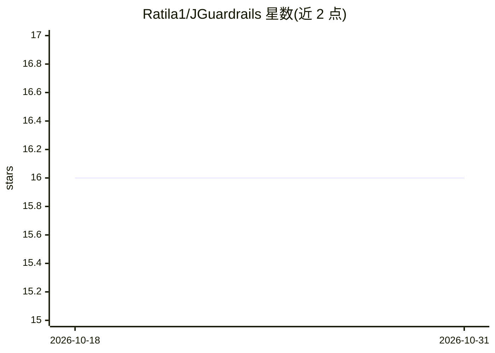

# Ratila1/JGuardrails

⭐ 16 · Java · NOASSERTION · 推送 2026-04-15 · [GitHub](https://github.com/Ratila1/JGuardrails) · 个人维护

**Java LLM 应用的可编程护栏库：输入/输出校验、PII 掩码、越狱检测**

面向 Java 17+ 开发者的框架无关 LLM 安全护栏工具包，以 InputRail/OutputRail 流水线形式在请求到达模型前与响应到达用户前执行校验，每个 rail 返回 PASS/BLOCK/MODIFY。内置检测器包括越狱/提示注入检测（regex + Aho-Corasick 混合引擎，本地运行无 API 调用）、PII 掩码（输入与输出两侧）、毒性检测、话题过滤、长度与 JSON 校验，覆盖 EN/RU/DE 等 13 种语言，支持 YAML 配置与自定义模式引擎。自身不调用 LLM。检测为模式匹配、无语义理解，混淆文本可能漏检。通过 JitPack/Maven/Gradle 或源码构建安装。

## 筛选速览

| 维度 | 判定 | 备注 |
|---|---|---|
| AI 角色 | `ai-ecosystem` | LLM/agent 周边工具 |
| 许可风险 | `none` | NOASSERTION |
| 部署形态 | `None` |  |
| 模型依赖 | — | README 未给出锁定关系 |
| 硬件要求 | — | 无带数字的原话,不猜 |
| 安装摩擦 | `medium` | 含编译或系统依赖之一 |
| 成熟度 | — | 结构信号不足 |

## 能力要点

- InputRail/OutputRail 流水线，每个 rail 返回 PASS/BLOCK/MODIFY，流水线本身不调用 LLM
- 越狱/提示注入检测采用 regex + Aho-Corasick 混合引擎，本地运行无需 API 调用
- 内置 PII 掩码、毒性检测、话题过滤、长度与 JSON schema 校验，含审计日志
- 支持 YAML 配置流水线与自定义匹配引擎，13 种语言检测覆盖

## 适用场景

- 在 Java LLM 应用中拦截提示注入与越狱尝试
- 用户输入发送给模型前掩码邮箱、电话、信用卡等 PII
- 阻止模型返回的毒性响应到达用户
- 通过 YAML 热配置护栏规则并留存审计记录

## 场景标签

`网络安全` · 领域:学习与行业

## 证据(README 行号)

> L16: JGuardrails is a framework-agnostic toolkit that adds programmable safety rails to any Java LLM application. Works 
> L52: User Input → [InputRail 1] → [InputRail 2] → ... → Your LLM
> L65: **Important:** the pipeline does **not** call the LLM itself. Your code calls the LLM — the pipeline only processes

## 星数曲线

2026-10-18 16 → 2026-10-31 16（+0）

---
*卡片 v1 · prompt 1.4 · 生成 2026-10-30 · 置信度 high · 依据 README sha `193f8e19a9ea` · [字段定义](../../DATASET.md)*
