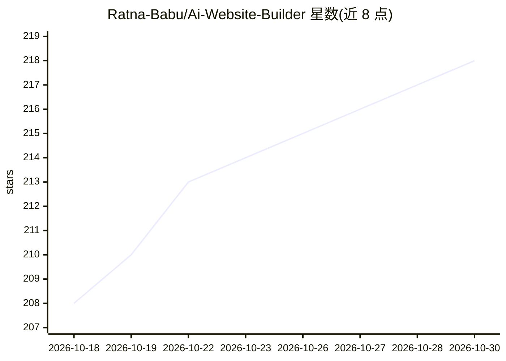

# Ratna-Babu/Ai-Website-Builder

⭐ 218 · JavaScript · 推送 2026-01-21 · [GitHub](https://github.com/Ratna-Babu/Ai-Website-Builder) · [官网](https://ai-website-builder-mu.vercel.app) · 个人维护

**面向无编程经验用户的自然语言生成网站工具**

基于 Next.js、Tailwind CSS 与 Convex 的 AI 网站生成应用：用户输入自然语言描述（如落地页、hero 区、定价卡片），调用 Gemini Flash 2.0 生成完整 React 组件与响应式 Tailwind 样式，内置实时预览、主题切换、导出与 SEO 优化内容。面向不需要编码经验的用户。需配置 GEMINI_API_KEY 与 NEXT_PUBLIC_CONVEX_URL，通过 git clone 与 npm 安装运行，可部署到 Vercel；README 注明部署版预览可能因 Vercel API 超时受限。

## 筛选速览

| 维度 | 判定 | 备注 |
|---|---|---|
| AI 角色 | `ai-native` | 本体是模型或模型工具 |
| 许可风险 | `permissive` | — |
| 部署形态 | `None` |  |
| 模型依赖 | — | README 未给出锁定关系 |
| 硬件要求 | — | 无带数字的原话,不猜 |
| 安装摩擦 | `low` | 无编译、无系统依赖或容器化 |
| 成熟度 | — | 结构信号不足 |

## 能力要点

- 自然语言生成 React 组件与响应式 Tailwind 样式
- 基于 Convex 后端的实时更新
- 内置实时预览、主题切换与导出
- 生成 SEO 优化内容与交互元素

## 适用场景

- 用自然语言描述直接生成落地页或营销网站
- 无需编码经验快速获得可导出的网站代码
- 在本地开发环境实时预览并调整 AI 生成结果

## 场景标签

`代码生成` · 领域:编码与开发

## 证据(README 行号)

> L24:  > 🌟 **AI Website Builder** is a cutting-edge platform that revolutionizes web development by combining the power o
> L128: - ✅ Complete React Components

## 星数曲线

2026-10-18 208 → 2026-10-30 218（+10）

---
*卡片 v1 · prompt 1.4 · 生成 2026-10-22 · 置信度 high · 依据 README sha `334963944dc0` · [字段定义](../../DATASET.md)*
