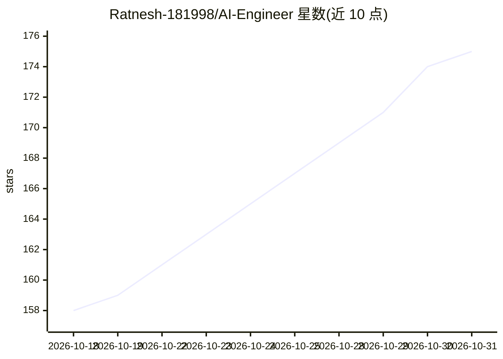

# Ratnesh-181998/AI-Engineer

⭐ 175 · Apache-2.0 · 推送 2026-09-03 · [GitHub](https://github.com/Ratnesh-181998/AI-Engineer) · [官网](https://www.youtube.com/@aiDotEngineer/videos) · 个人维护

**AI 工程主题图文笔记合集：Agentic AI、GenAI、RAG 概念图解**

个人维护的 AI 工程知识聚合仓库，以图片和信息图为主，覆盖 Agentic AI、生成式 AI、LLM、RAG 架构（12 种 RAG 架构分类）、Agent 框架对比（LangGraph/CrewAI/AutoGen 等）、微调技术（LoRA/QLoRA/RLHF 等 15 种）、MCP 与 A2A 协议、向量数据库（Pinecone/Weaviate/FAISS）等主题。条目多为外部图片、arXiv 论文链接、YouTube 播放列表与 Substack 文章的引用集合，不含可运行的代码。面向学习 AI 工程概念的开发者与求职者。

## 筛选速览

| 维度 | 判定 | 备注 |
|---|---|---|
| AI 角色 | `ai-knowledge` | 知识聚合/清单类 |
| 许可风险 | `permissive` | Apache-2.0 |
| 部署形态 | `None` |  |
| 模型依赖 | — | README 未给出锁定关系 |
| 硬件要求 | — | 无带数字的原话,不猜 |
| 安装摩擦 | `low` | 无编译、无系统依赖或容器化 |
| 成熟度 | — | 结构信号不足 |

## 能力要点

- 以'AI 元素周期表'方式组织 AI 系统概念（Prompt/Embedding/RAG/Agent 等）
- 收录 15 种 LLM 微调技术与 12 种 RAG 架构的图解
- 包含 MCP 与 A2A 协议、Agent 记忆架构等专题说明
- 附 arXiv 论文链接、YouTube 播放列表等外部学习资源

## 适用场景

- 系统学习 Agentic AI 与 RAG 的概念与架构
- 准备 AI 工程师/LLM 微调工程师面试
- 了解主流 Agent 框架与向量数据库生态

## 场景标签

`教程课程` `精选清单` · 领域:学习与行业

## 证据(README 行号)

> L5: ## Agentic AI | Generative AI | LLMs | RAG | Agentic AI Frameworks 🌈 TOPICS detailed explanations
> L119:  - AI systems are becoming increasingly complex — LLMs, RAG, agents, tools, guardrails, multimodal models… it’s ea
> L235: - This visual brings together 12 major RAG architectures—from Naïve RAG to Tool-Integrated and Federated RAG—highl

## 星数曲线

2026-10-18 158 → 2026-10-31 175（+17）

---
*卡片 v1 · prompt 1.4 · 生成 2026-10-22 · 置信度 high · 依据 README sha `e780afad5d52` · [字段定义](../../DATASET.md)*
