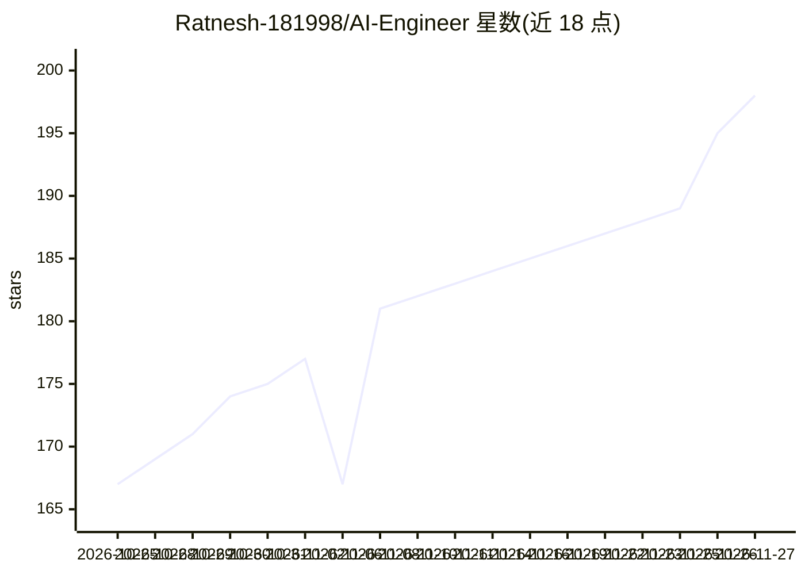

# Ratnesh-181998/AI-Engineer

⭐ 198 · Apache-2.0 · 推送 2026-11-06 · [GitHub](https://github.com/Ratnesh-181998/AI-Engineer) · [官网](https://www.youtube.com/@aiDotEngineer/videos) · 个人维护

**面向 AI 工程学习者的 Agentic AI 与 GenAI 主题图文讲解合集**

以图解为主的知识聚合仓库：用示意图、cheatsheet 和外部链接讲解 RAG 架构（含 12 种架构分类）、Agent 设计模式（20 种）、LLM 微调技术（LoRA/RLHF/DPO 等）、MCP 与 A2A 协议、向量数据库、嵌入与防护栏等主题，内容多源自作者发布的推文截图。无代码工程、无安装与运行说明，仅附 arXiv 论文链接、MIT 免费课程与 YouTube 播放列表等学习资源。适合入门 AI 工程概念的学习者。

## 筛选速览

| 维度 | 判定 | 备注 |
|---|---|---|
| AI 角色 | `ai-knowledge` | 知识聚合/清单类 |
| 许可风险 | `permissive` | Apache-2.0 |
| 部署形态 | `None` |  |
| 模型依赖 | — | README 未给出锁定关系 |
| 硬件要求 | — | 无带数字的原话,不猜 |
| 安装摩擦 | `low` | 无编译、无系统依赖或容器化 |
| 成熟度 | — | 结构信号不足 |

## 能力要点

- 12 种 RAG 架构的视觉分类图解
- 20 种 Agentic AI 设计模式讲解
- MCP 与 A2A 协议的可视化解释与 Agent Card 机制说明
- 附 arXiv 论文与 MIT/YouTube 学习资源链接

## 适用场景

- 系统学习 RAG、Agent 与微调等 AI 工程概念
- 准备 AI 工程师面试（含微调面试题图解）
- 查找免费课程、论文与视频播放列表等学习材料

## 场景标签

`教程课程` `精选清单` · 领域:学习与行业

## 证据(README 行号)

> L5: ## Agentic AI | Generative AI | LLMs | RAG | Agentic AI Frameworks 🌈 TOPICS detailed explanations
> L109: ### A RAG chatbot = PR + EM + VX + RG + LG + GR
> L660: # MIT literally packed 7 hours with everything:

## 星数曲线

2026-10-25 167 → 2026-11-27 198（+31）

---
*卡片 v1 · prompt 1.4 · 生成 2026-11-27 · 置信度 high · 依据 README sha `21b7bef731dd` · [字段定义](../../DATASET.md)*
