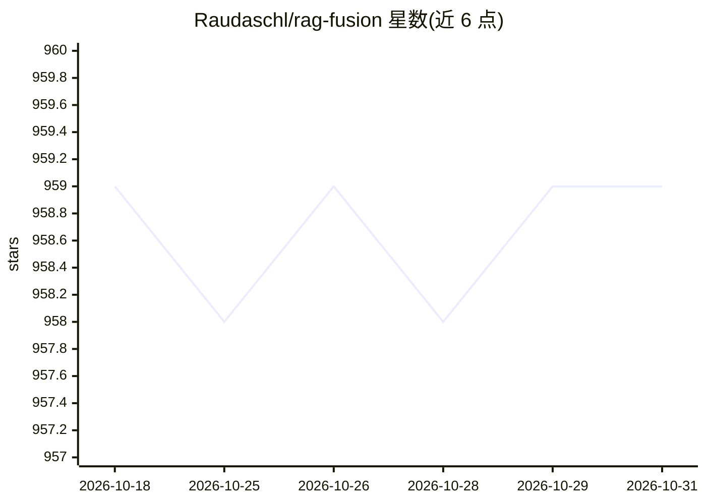

# Raudaschl/rag-fusion

⭐ 959 · Python · MIT · 推送 2026-10-10 · [GitHub](https://github.com/Raudaschl/rag-fusion) · 个人维护

**RAG-Fusion 检索技术实现：多查询生成+RRF融合+评测**

实现 RAG-Fusion 检索方法的 Python 项目：LLM 生成多条查询改写，对原查询与改写分别做 BM25+向量混合检索，用 Reciprocal Rank Fusion 合并排名，再经重排器重排后供生成模型使用。附带在 NFCorpus（BEIR）数据集上的评测框架，对比六种检索策略并给出置信区间；实验目录记录了多种重排器（bge-reranker-large、Jev、OpenAI Decisions API、Microsoft-Decision-1）下的结果与成本延迟分析。面向构建 RAG 检索管线的开发者。

## 筛选速览

| 维度 | 判定 | 备注 |
|---|---|---|
| AI 角色 | `ai-ecosystem` | LLM/agent 周边工具 |
| 许可风险 | `permissive` | MIT |
| 部署形态 | `library` | 以包/库形式分发 |
| 模型依赖 | — | README 未给出锁定关系 |
| 硬件要求 | — | 无带数字的原话,不猜 |
| 安装摩擦 | `low` | 无编译、无系统依赖或容器化 |
| 成熟度 | — | 结构信号不足 |

## 能力要点

- LLM 多查询改写 + BM25/向量混合检索 + RRF 融合管线
- 内置 NFCorpus（3,633 文档/323 查询）评测框架，六策略对比含 bootstrap 置信区间
- 多种重排器实验（bge-reranker-large、Jev、OpenAI Decisions API、Microsoft-Decision-1）
- README 明确给出适用/不适用场景（术语错配、召回优先 vs 延迟敏感、FAQ 问答等）

## 适用场景

- 我的检索语料与用户词汇错配，召回不足，想改写查询提升覆盖
- 在标准 BEIR 数据集上量化对比检索融合策略
- 评估加混合检索与重排后对最终答案质量的影响

## 场景标签

`RAG` `模型评测` · 领域:评测与运维

## 证据(README 行号)

> L9: RAG-Fusion is a search methodology that aims to bridge the gap between traditional search paradigms and the multifac
> L30: 1. **Query generation:** an LLM writes several rewrites of the user's query that come at it from different angles (
> L31: 2. **Hybrid search:** the original query and every rewrite are searched twice, with BM25 (keywords) and with vector
> L32: 3. **Reciprocal Rank Fusion:** the lists are merged, and each document scores 1 / (60 + rank) summed over every lis

## 星数曲线

2026-10-18 959 → 2026-10-31 959（+0）

---
*卡片 v1 · prompt 1.4 · 生成 2026-10-21 · 置信度 high · 依据 README sha `775184716eab` · [字段定义](../../DATASET.md)*
