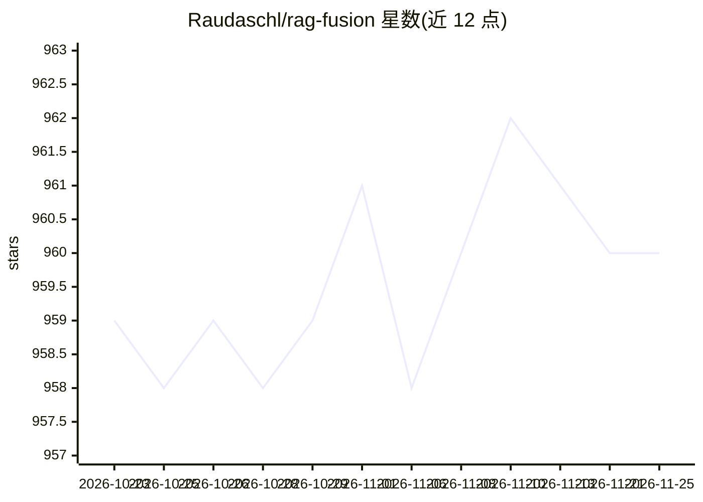

# Raudaschl/rag-fusion

⭐ 960 · Python · MIT · 推送 2026-11-22 · [GitHub](https://github.com/Raudaschl/rag-fusion) · [官网](https://adrianraudaschl.com/projects/rag-fusion/) · 个人维护

**面向开发者的 RAG-Fusion 检索技术实现与评测工具集**

实现 RAG-Fusion 检索方法的仓库：用 LLM 生成多个查询改写，对原查询与改写分别做 BM25 与向量混合检索，经 Reciprocal Rank Fusion 合并后可选接 reranker 重排，再交给 LLM 生成答案。仓库包含核心流水线 main.py、单元测试，以及基于 BEIR/NFCorpus 数据集的定量评测框架，比较六种检索策略并给出置信区间；另附多篇实验 write-up 覆盖成本、延迟与端到端答案质量评估。需要 OpenAI API key 运行完整流水线，测试可离线运行。

## 筛选速览

| 维度 | 判定 | 备注 |
|---|---|---|
| AI 角色 | `ai-ecosystem` | LLM/agent 周边工具 |
| 许可风险 | `permissive` | MIT |
| 部署形态 | `library` | 以包/库形式分发 |
| 模型依赖 | — | README 未给出锁定关系 |
| 硬件要求 | — | 无带数字的原话,不猜 |
| 安装摩擦 | `low` | 无编译、无系统依赖或容器化 |
| 成熟度 | — | 结构信号不足 |

## 能力要点

- LLM 多查询改写 + BM25/向量混合检索 + RRF 融合
- 基于 BEIR/NFCorpus 的定量评测框架（n=200 配对 bootstrap 置信区间）
- 可选 rerank 阶段，支持 bge-reranker-large 与决策模型
- 附多篇实验 write-up，含成本/延迟分析

## 适用场景

- 评估多种 RAG 检索策略在真实语料上的召回与排序差异
- 为查询词与索引术语不匹配的语料库部署多查询融合检索
- 复现论文中的 RAG-Fusion 基线并进行自己的实验

## 场景标签

`RAG` `模型评测` · 领域:评测与运维

## 证据(README 行号)

> L9: RAG-Fusion is a search methodology that aims to bridge the gap between traditional search paradigms and the multifac
> L36: The original version of the technique used vector search only and no reranker, and that's what `main.py` still demo

## 星数曲线

2026-10-23 959 → 2026-11-25 960（+1）

---
*卡片 v1 · prompt 1.4 · 生成 2026-11-24 · 置信度 high · 依据 README sha `bdc58d5af376` · [字段定义](../../DATASET.md)*
