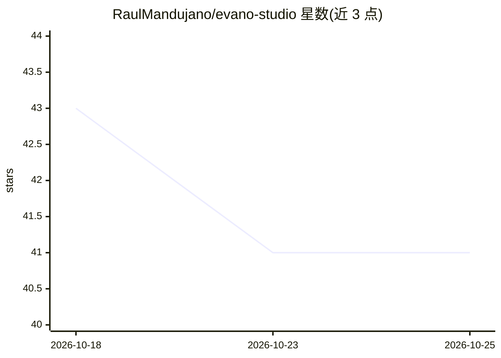

# RaulMandujano/evano-studio

⭐ 41 · Python · AGPL-3.0 · 推送 2026-06-16 · [GitHub](https://github.com/RaulMandujano/evano-studio) · [官网](https://www.evanostudio.com/) · 个人维护

**面向非技术用户的本地 AI agent 桌面控制台（开源）**

基于 Electron + React + Python/FastAPI 的本地优先桌面应用，让不写代码的用户通过图形界面创建、运行和管理 OpenClaw agent：支持从模板建 agent、多 agent 团队接力、组织架构权限、Discord bot 接入、ChromaDB 本地 RAG 知识库、ComfyUI 本地图像生成及例行任务调度。本地推理依赖用户自装的 Ollama（必需）与可选 ComfyUI，模型推荐 Gemma 系。处于公开 alpha，无签名安装包，需从源码运行（Node≥20、pnpm≥9、Python≥3.10）。

## 筛选速览

| 维度 | 判定 | 备注 |
|---|---|---|
| AI 角色 | `ai-native` | 本体是模型或模型工具 |
| 许可风险 | `viral` | AGPL-3.0 |
| 部署形态 | `library` | 以包/库形式分发 |
| 模型依赖 | local-ok | 支持本地模型 |
| 硬件要求 | — | 无带数字的原话,不猜 |
| 安装摩擦 | `low` | 无编译、无系统依赖或容器化 |
| 成熟度 | `idea` | |

## 能力要点

- 图形化创建与管理 OpenClaw agent（模板、团队接力、组织架构权限）
- ChromaDB 本地持久化 RAG 知识库，聊天与 Discord 同步使用
- 本地图像生成（可选 ComfyUI 实例）与例行任务/日历调度
- 本地优先：模型、文档与数据留在本机，AGPL-3.0 开源

## 适用场景

- 不会编程的创作者或小企业主在本地搭建 AI 助手做文档起草与知识库问答
- 为业务流程配置多 agent 团队并接入 Discord 作为各自 bot
- 在不依赖付费 API 和云端的前提下运行私有 AI agent

## 场景标签

`AI 助手` `多智能体` `文档问答` `图像生成` · 领域:Agent 开发

## 证据(README 行号)

> L16: Evano Studio is a **free, open-source, local-first desktop application** that lets normal people — creators, startu
> L18: It is designed to feel like a simple desktop **control center**, not a developer tool. You don't install Python pac
> L65: |Local AI runtime|Ollama|

## 星数曲线

2026-10-18 43 → 2026-10-25 41（-2）

---
*卡片 v1 · prompt 1.4 · 生成 2026-10-25 · 置信度 high · 依据 README sha `fa8599de9dcd` · [字段定义](../../DATASET.md)*
