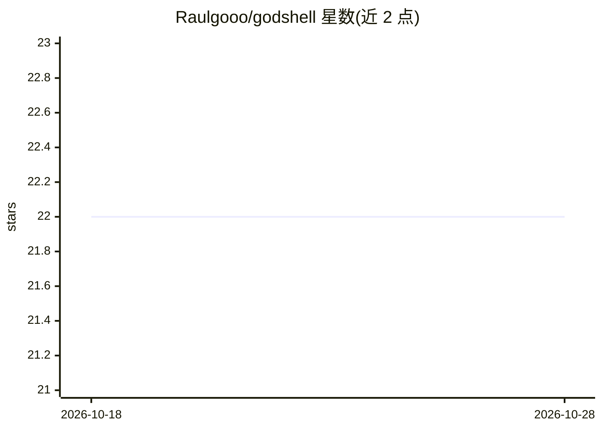

# Raulgooo/godshell

⭐ 22 · Go · MIT · 推送 2026-03-18 · [GitHub](https://github.com/Raulgooo/godshell) · 个人维护

**基于 eBPF 的 Linux 内核可观测层，供 LLM 自然语言查询系统状态**

godshell 由两部分组成：godshell-daemon 是由 systemd 管理的 Go 服务，通过 eBPF tracepoint 挂入内核，自启动起持续采集进程创建、内存映射、网络连接与进程-文件关系等事件，存入 SQLite 并以 UNIX socket 上的 HTTP 暴露；godshell-tui 用 BubbleTea 构建终端界面，渲染进程树与事件时间线，自然语言查询经 OpenRouter 转发给任意模型。支持快照、ghost 进程（追踪已退出进程）、无文件恶意软件检测、内存字符串提取等工具。要求 Linux 内核 5.8+ 且启用 BTF，trace 功能当前依赖 strace。项目自述仍为实验性，提供发行版软件包与源码编译两种安装方式。

## 筛选速览

| 维度 | 判定 | 备注 |
|---|---|---|
| AI 角色 | `ai-native` | 本体是模型或模型工具 |
| 许可风险 | `permissive` | MIT |
| 部署形态 | `None` |  |
| 模型依赖 | locked-api |  |
| 硬件要求 | — | 无带数字的原话,不猜 |
| 安装摩擦 | `low` | 无编译、无系统依赖或容器化 |
| 成熟度 | `idea` | |

## 能力要点

- eBPF tracepoint 持续采集进程/内存/网络/文件事件入 SQLite 快照
- TUI 中自然语言查询系统状态，模型经 OpenRouter 可自选
- ghost processes 追踪并分析已退出进程
- 文件内恶意软件检测、内存字符串提取、进程谱系与网络连接分析工具集

## 适用场景

- 安全分析：排查可疑进程、检测无文件恶意软件
- 事后取证：查询历史快照与已退出进程的活动
- 系统调试：用自然语言询问当前或过去的系统状态

## 场景标签

`网络安全` · 领域:学习与行业

## 证据(README 行号)

> L2: ### An LLM-native observability layer built on eBPF
> L34: **`godshell-tui`** — built with Bubbletea. reads daemon state, renders the process tree and event timeline, lets yo
> L47: - **natural language queries** — ask anything about current or past system state. the LLM gets the full structured 

## 星数曲线

2026-10-18 22 → 2026-10-28 22（+0）

---
*卡片 v1 · prompt 1.4 · 生成 2026-10-27 · 置信度 high · 依据 README sha `2da5916292bc` · [字段定义](../../DATASET.md)*
