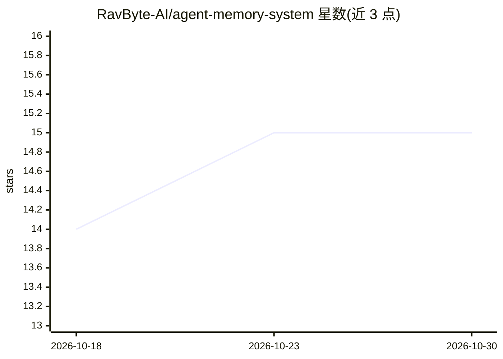

# RavByte-AI/agent-memory-system

⭐ 15 · TypeScript · MIT · 推送 2026-05-19 · [GitHub](https://github.com/RavByte-AI/agent-memory-system) · [官网](https://ravbyte-ai.github.io/agent-memory-system/) · 组织维护

**为 AI 编程代理生成仓库本地记忆、工作日志与交接文件的 TypeScript CLI**

TypeScript CLI 工具，在仓库内生成可审查的 Markdown 与 JSON 产物：项目结构、工作流命令、API/存储/安全说明、静态代码依赖图、agent 工作日志（checkpoint）与交接文件，供 Codex、Claude Code、Cursor、Gemini CLI 等编程代理在会话间读取以复用上下文。含无头静态分析引擎（graph build/query/diff）与维护者自跑的基准工具（结果标注为早期测量）。明确声明非聊天记忆服务、向量库或 agent 运行时。通过 npx/npm 安装运行。

## 筛选速览

| 维度 | 判定 | 备注 |
|---|---|---|
| AI 角色 | `ai-ecosystem` | LLM/agent 周边工具 |
| 许可风险 | `permissive` | MIT |
| 部署形态 | `library` | 以包/库形式分发 |
| 模型依赖 | — | README 未给出锁定关系 |
| 硬件要求 | — | 无带数字的原话,不猜 |
| 安装摩擦 | `low` | 无编译、无系统依赖或容器化 |
| 成熟度 | `idea` | |

## 能力要点

- 生成 AGENTS.md、context-index、项目概览、API/测试说明等记忆产物
- 静态依赖图与 blast-radius 查询（graph build/query/diff）
- append-only 工作日志 checkpoint 与 agent 交接文件
- 安全模型：不记录环境变量值、校验秘密模式、标注 [INFERRED]/[INCOMPLETE]

## 适用场景

- 让编程代理跨会话恢复工作而不重新遍历代码库
- 编辑共享接口前查询影响范围
- 多代理协作时记录交接状态

## 场景标签

`Agent 记忆` · 领域:Agent 开发

## 证据(README 行号)

> L13: Agent Memory System is a TypeScript CLI that creates a repository-local memory layer for AI coding agents. It gener
> L17: AMS is not a chatbot memory service, vector database, or agent runtime. It is a repo-local context layer for tools 

## 星数曲线

2026-10-18 14 → 2026-10-30 15（+1）

---
*卡片 v1 · prompt 1.4 · 生成 2026-10-30 · 置信度 high · 依据 README sha `759204d6948d` · [字段定义](../../DATASET.md)*
