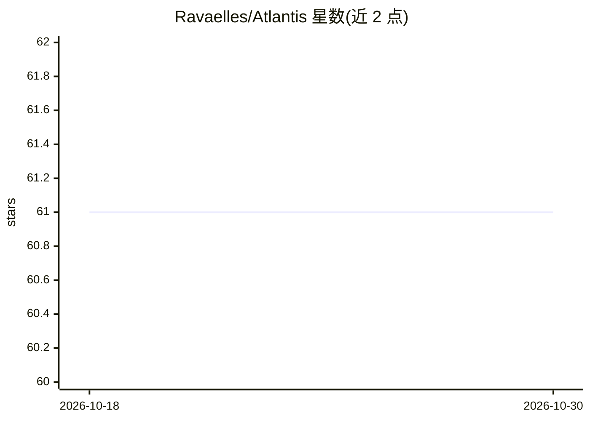

# Ravaelles/Atlantis

⭐ 61 · Java · MIT · 推送 2026-10-28 · [GitHub](https://github.com/Ravaelles/Atlantis) · 个人维护

**星际争霸母巢之战 AI 机器人开发 Java 框架**

基于 JBWAPI 2.1.0 的 Java 框架，用于开发星际争霸母巢之战（StarCraft BroodWar）AI 机器人。框架封装底层 API，内置经济管理（采集、建造、工人分配至最优矿区）、侦察与敌方建造顺序识别、针对性防御建造、单位微操管理器、自动扩张与遭遇战胜率评估撤退等功能；支持三种种族（以 Terran 为主），可通过自定义建造顺序与 AConfig 类配置种族、地图与游戏类型。在 IDE 中一键运行即可自动启动 Chaoslauncher 与 StarCraft。使用者需自行安装 BWAPI 4.4.0 并在游戏中创建玩家档案，然后按 Wiki 步骤在 IDE 中运行 Main 类。

## 筛选速览

| 维度 | 判定 | 备注 |
|---|---|---|
| AI 角色 | `ai-ecosystem` | LLM/agent 周边工具 |
| 许可风险 | `permissive` | MIT |
| 部署形态 | `None` |  |
| 模型依赖 | — | README 未给出锁定关系 |
| 硬件要求 | — | 无带数字的原话,不猜 |
| 安装摩擦 | `low` | 无编译、无系统依赖或容器化 |
| 成熟度 | — | 结构信号不足 |

## 能力要点

- 封装 BWAPI/JBWAPI 底层调用，减少机器人开发样板代码
- 内置经济管理、侦察、微操管理器与自动扩张
- 遭遇战胜率评估并在不利时撤退
- IDE 中一键运行，自动启动 Chaoslauncher 与 StarCraft 并修改 bwapi.ini

## 适用场景

- 开发星际争霸母巢之战 AI 机器人
- 参加 SSCAIT 等 AI 机器人线上赛事
- 利用内置测试与迷你地图调试机器人策略

## 场景标签

`Agent 框架` · 领域:Agent 开发

## 证据(README 行号)

> L2: ...is an extensive Java framework based on JBWAPI 2.1.0
> L10: - enables to you to run your bot in *one* click from your IDE (IntelliJ IDEA recommend), just "Run" your project an

## 星数曲线

2026-10-18 61 → 2026-10-30 61（+0）

---
*卡片 v1 · prompt 1.4 · 生成 2026-10-24 · 置信度 mid · 依据 README sha `090d52244cd7` · [字段定义](../../DATASET.md)*
