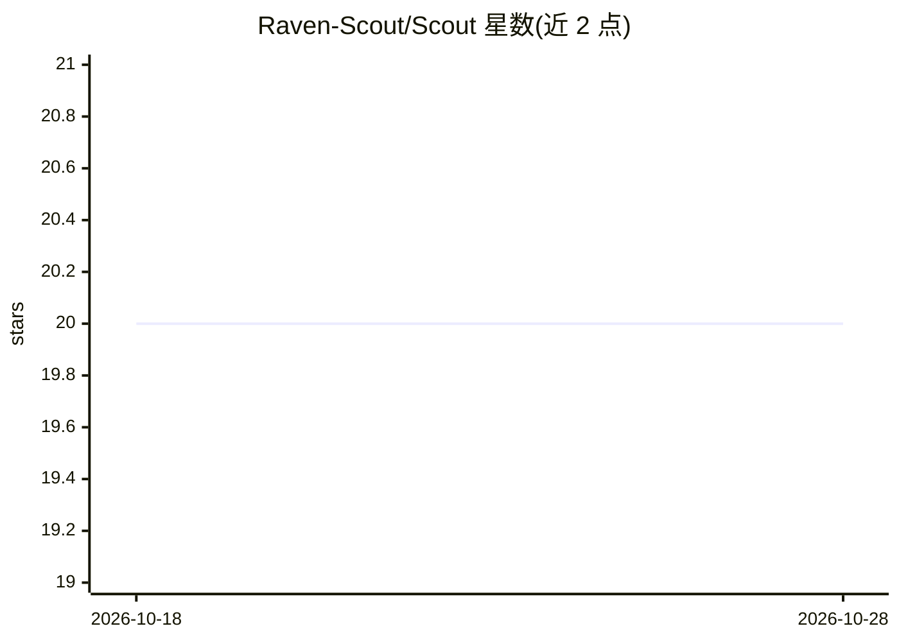

# Raven-Scout/Scout

⭐ 20 · Python · MIT · 推送 2026-10-27 · [GitHub](https://github.com/Raven-Scout/Scout) · [官网](https://raven-scout.github.io/Scout/) · 组织维护

**面向 Claude Code 的自动日程简报与个人知识管理工具**

由 Claude Code 插件与 macOS 菜单栏应用两部分组成：插件的 Python 引擎（scoutctl）按计划交叉核对 Slack、Gmail、Calendar、Linear 与 GitHub 等工作工具，维护一个 Obsidian 兼容的持久知识库（默认 ~/Scout）；菜单栏应用提供 Control Center、Action Items、知识库与日程管理界面。安装路径为下载 dmg 拖入 Applications，由应用引导完成引擎安装、连接器配置与日程注册；也可用 install.sh 无应用安装。应用与插件自 v0.16 起共用一个版本号、随同一 GitHub release 发布。

## 筛选速览

| 维度 | 判定 | 备注 |
|---|---|---|
| AI 角色 | `ai-native` | 本体是模型或模型工具 |
| 许可风险 | `permissive` | MIT |
| 部署形态 | `desktop` | 安装包/桌面程序 |
| 模型依赖 | locked-api |  |
| 硬件要求 | — | 无带数字的原话,不猜 |
| 安装摩擦 | `low` | 无编译、无系统依赖或容器化 |
| 成熟度 | — | 结构信号不足 |

## 能力要点

- 定时引擎交叉核对 Slack/Gmail/Calendar/Linear/GitHub 并生成简报
- 维护 Obsidian 兼容的持久知识库
- macOS 菜单栏应用读取与操控引擎
- 提供 dmg 安装包或 install.sh 两种安装路径

## 适用场景

- 每天自动汇总跨工作工具的事项，避免遗漏
- 把工作工具信息沉淀为 Obsidian 兼容的个人知识库
- 在菜单栏查看 Action Items 并操控 Scout 会话日程

## 场景标签

`知识库管理` `AI 助手` · 领域:对话与助手

## 证据(README 行号)

> L3: Autonomous knowledge management and daily briefing for Claude Code — a
> L4: scheduled engine that cross-checks your work tools and maintains a persistent,
> L11: |`plugin/`|The Claude Code plugin and its Python engine (`scoutctl`). This is the part that does the work.|

## 星数曲线

2026-10-18 20 → 2026-10-28 20（+0）

---
*卡片 v1 · prompt 1.4 · 生成 2026-10-28 · 置信度 mid · 依据 README sha `36f957a38f42` · [字段定义](../../DATASET.md)*
