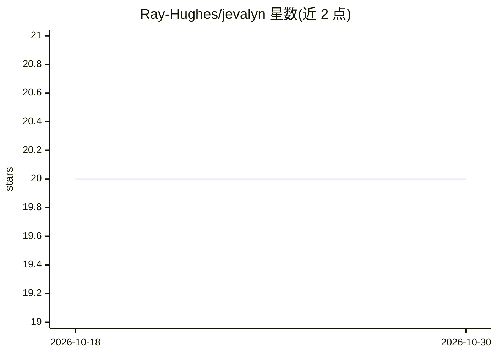

# Ray-Hughes/jevalyn

⭐ 20 · Ruby · MIT · 推送 2026-09-21 · [GitHub](https://github.com/Ray-Hughes/jevalyn) · 个人维护

**Rails 决策层封装：在控制流中调用 Jev 模型做类型化决策**

Ruby gem，封装 TypeSafe 的 Jev（System One 模型）API，供 Rails 应用在请求控制流中做出类型化、带置信度的决策。提供三种问题类型（noul 是非判断返回概率、choice 单选返回分布、score 评级返回加权分），支持按问题设置置信度阈值、Guardrail 放行检查（API 失败时默认拒绝而非放行）、Router 分发表，以及 RSpec/Minitest 本地 mock 测试与录像回放。Jev 不生成文本，输入 token 计费，需申请 TYPESAFE_API_KEY。

## 筛选速览

| 维度 | 判定 | 备注 |
|---|---|---|
| AI 角色 | `ai-ecosystem` | LLM/agent 周边工具 |
| 许可风险 | `permissive` | MIT |
| 部署形态 | `None` |  |
| 模型依赖 | — | README 未给出锁定关系 |
| 硬件要求 | — | 无带数字的原话,不猜 |
| 安装摩擦 | `low` | 无编译、无系统依赖或容器化 |
| 成熟度 | — | 结构信号不足 |

## 能力要点

- 三种类型化问题：noul/choice/score，一次请求并行评估
- Guardrail 放行检查，API 失败时默认拒绝（fail closed）
- 按问题粒度的置信度阈值与 certainty 边距计算
- 本地 mock_mode 测试支持 RSpec/Minitest 与 cassette 回放

## 适用场景

- 在 Rails 工单流转中做部门路由与严重程度评级
- 为工具调用或自动审批设置带置信度下限的放行检查
- 为确定性决策省去提示词与 JSON 解析重试逻辑

## 场景标签

 · 领域:LLM 应用开发/决策系统

## 证据(README 行号)

> L22: **Jevalyn is the decision layer for your Rails app**, built on
> L29: Jevalyn wraps TypeSafe's Jev, a **System One** model. You

## 星数曲线

2026-10-18 20 → 2026-10-30 20（+0）

---
*卡片 v1 · prompt 1.4 · 生成 2026-10-28 · 置信度 high · 依据 README sha `5bc0b7262bdb` · [字段定义](../../DATASET.md)*
