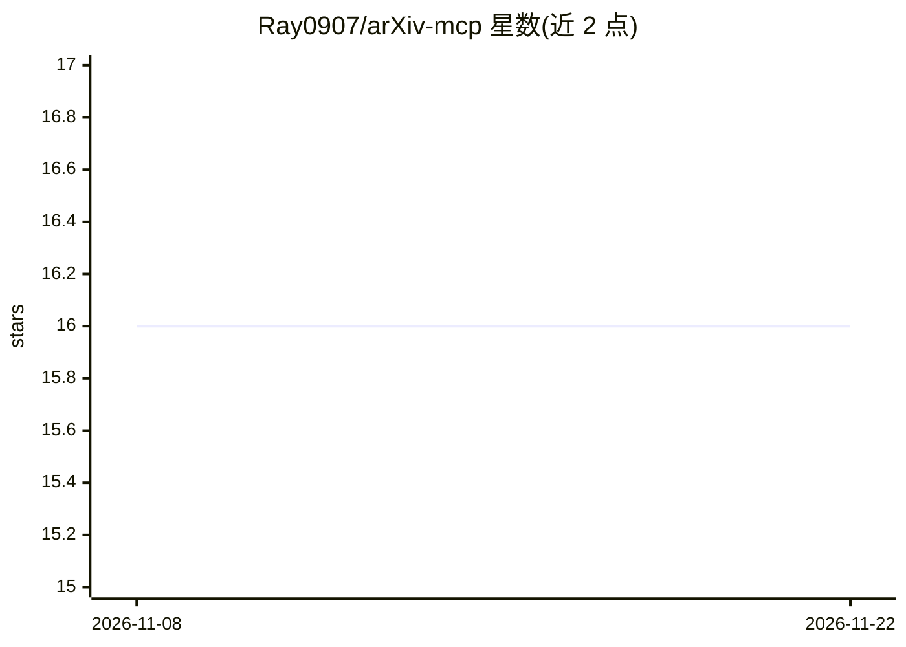

# Ray0907/arXiv-mcp

⭐ 16 · Python · MIT · 推送 2026-11-12 · [GitHub](https://github.com/Ray0907/arXiv-mcp) · 个人维护

**供 LLM 客户端检索 arXiv 论文的 MCP 服务器**

面向 Claude、ChatGPT 等 MCP 客户端的 arXiv 检索服务器：提供关键词/作者/分类/日期搜索、高级字段过滤、批量元数据查询、BibTeX 导出（仅用 API 数据，不虚构引文信息）、通过 MCP resource link 经 Jina Reader 读取全文（HTML 优先、PDF 回退）、按章节或固定分块的有界阅读视图、Semantic Scholar 的参考文献/引文查询，以及分类浏览与全部分类列表。全文按进程内缓存（32 篇，1–24 小时过期），arXiv API 请求间隔 3 秒以遵守 API 条款。图形 API 未认证时共享 Semantic Scholar 全局限速。

## 筛选速览

| 维度 | 判定 | 备注 |
|---|---|---|
| AI 角色 | `ai-ecosystem` | LLM/agent 周边工具 |
| 许可风险 | `permissive` | MIT |
| 部署形态 | `library` | 以包/库形式分发 |
| 模型依赖 | locked-api |  |
| 硬件要求 | — | 无带数字的原话,不猜 |
| 安装摩擦 | `low` | 无编译、无系统依赖或容器化 |
| 成熟度 | — | 结构信号不足 |

## 能力要点

- 搜索/高级搜索/批量查询单次最多 50 篇论文元数据
- 全文经 MCP resource link 由 Jina Reader 读取，不嵌入工具结果
- read_paper 提供大纲、章节选择与 10,000 字符固定分块及续读 offset
- BibTeX 导出仅使用 API 数据，引文键为 arxiv:<无版本 ID>

## 适用场景

- 在 Claude/ChatGPT 等 MCP 客户端中搜索并阅读 arXiv 论文
- 批量导出论文 BibTeX 引用
- 通过 Semantic Scholar 查看论文的参考文献与被引情况

## 场景标签

`科研工具` · 领域:学习与行业

## 证据(README 行号)

> L3: A Model Context Protocol (MCP) server that provides arXiv paper search and retrieval capabilities. This server enabl
> L121: ### `get_references` / `get_citations`
> L153: - Results come from the official arXiv API (`export.arxiv.org/api/query`). Requests are spaced 3 seconds

## 星数曲线

2026-11-08 16 → 2026-11-22 16（+0）

---
*卡片 v1 · prompt 1.4 · 生成 2026-11-18 · 置信度 high · 依据 README sha `be250d10d232` · [字段定义](../../DATASET.md)*
