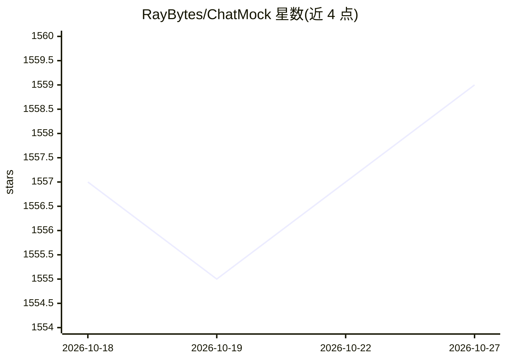

# RayBytes/ChatMock

⭐ 1,559 · Python · MIT · 推送 2026-10-22 · [GitHub](https://github.com/RayBytes/ChatMock) · 个人维护

**把 ChatGPT 账号的 Codex 模型暴露为 OpenAI/Ollama 兼容本地 API**

以 ChatGPT 账号登录后，在本地 127.0.0.1:8000 启动服务，将账号可用的 gpt-5.x 系列模型通过 OpenAI 兼容 /v1/responses（HTTP+WebSocket）与 Ollama 兼容端点对外提供，供 Raycast、Terax 等聊天应用和编码工具接入。支持工具调用、视觉输入、思考摘要与推理力度配置、可选网页搜索与 fast mode，模型目录自动发现与刷新。提供 Homebrew、pipx/pip、GUI 安装包与 Docker 文档；声明与 OpenAI 无关联，需自担风险使用。

## 筛选速览

| 维度 | 判定 | 备注 |
|---|---|---|
| AI 角色 | `ai-ecosystem` | LLM/agent 周边工具 |
| 许可风险 | `permissive` | MIT |
| 部署形态 | `library` | 以包/库形式分发 |
| 模型依赖 | local-ok | 支持本地模型 |
| 硬件要求 | — | 无带数字的原话,不猜 |
| 安装摩擦 | `low` | 无编译、无系统依赖或容器化 |
| 成熟度 | — | 结构信号不足 |

## 能力要点

- OpenAI 兼容 /v1/responses（HTTP + WebSocket）与 Ollama 兼容端点
- 自动发现并同步 ChatGPT 账号可用模型
- 工具调用、视觉输入、思考摘要与可配置推理力度
- 可选网页搜索与 fast mode

## 适用场景

- 让 Raycast 等仅支持 OpenAI/Ollama 协议的应用调用 Codex 模型
- 在编码工具中以 OpenAI 兼容 API 使用 ChatGPT 账号模型
- 通过 API 请求开启网页搜索或 fast mode

## 场景标签

`推理引擎` · 领域:训练与推理

## 证据(README 行号)

> L42: The server runs at `http://127.0.0.1:8000` by default. Use `http://127.0.0.1:8000/v1` as your base URL for OpenAI-c
> L90: - Ollama-compatible endpoints

## 星数曲线

2026-10-18 1,557 → 2026-10-27 1,559（+2）

---
*卡片 v1 · prompt 1.4 · 生成 2026-10-21 · 置信度 high · 依据 README sha `b9324af12c5e` · [字段定义](../../DATASET.md)*
