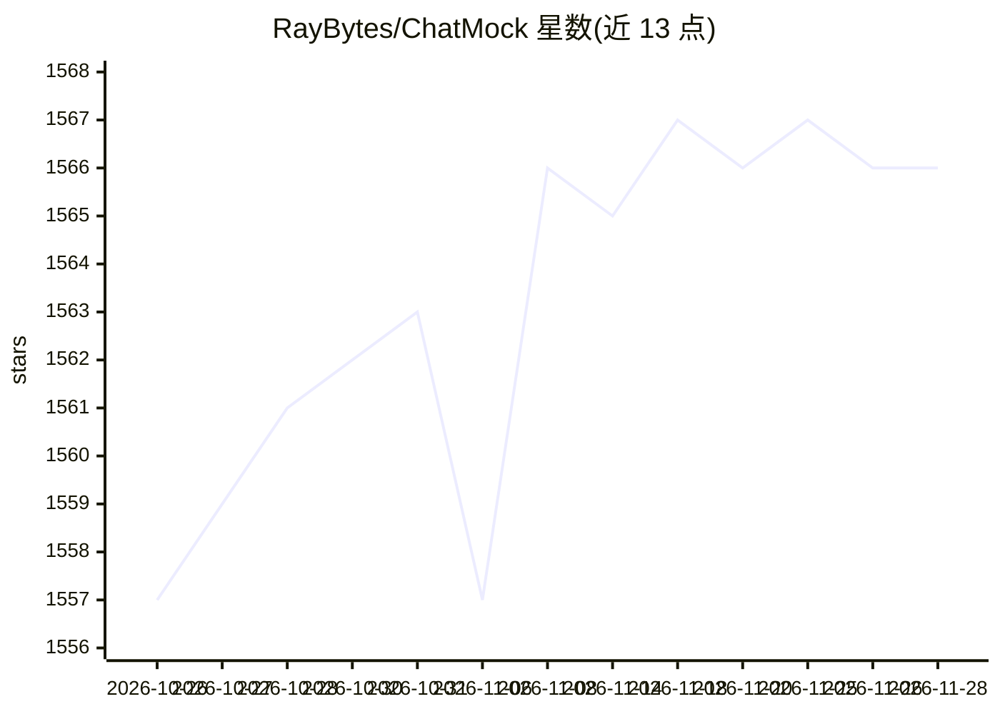

# RayBytes/ChatMock

⭐ 1,566 · Python · MIT · 推送 2026-11-03 · [GitHub](https://github.com/RayBytes/ChatMock) · 个人维护

**让 Codex 模型以 OpenAI/Ollama 兼容 API 供聊天工具调用的本地服务器**

基于 Codex 的本地代理服务器：用户登录 ChatGPT 账号后，启动服务在本地 8000 端口暴露 OpenAI 兼容的 /v1 接口与 Ollama 兼容端点，使 Raycast、Terax 等聊天与编码工具无需 API key 即可调用账号内可用模型。自动发现账号可用模型清单，支持工具调用、结构化输出、视觉输入、思维摘要、联网搜索等特性，可通过命令行标志或环境变量配置。README 声明项目与 OpenAI 无关联。

## 筛选速览

| 维度 | 判定 | 备注 |
|---|---|---|
| AI 角色 | `ai-ecosystem` | LLM/agent 周边工具 |
| 许可风险 | `permissive` | MIT |
| 部署形态 | `library` | 以包/库形式分发 |
| 模型依赖 | local-ok | 支持本地模型 |
| 硬件要求 | — | 无带数字的原话,不猜 |
| 安装摩擦 | `low` | 无编译、无系统依赖或容器化 |
| 成熟度 | — | 结构信号不足 |

## 能力要点

- 暴露 OpenAI 兼容 /v1/responses（HTTP + WebSocket）与 Ollama 兼容端点
- 自动发现登录账号可用的模型清单，支持 --no-model-sync 静态列表
- 支持工具/函数调用、JSON schema 结构化输出、视觉输入、思维摘要与推理力度配置
- 提供 Homebrew、pipx 与 Docker 三种安装方式

## 适用场景

- 在 Raycast AI Chat 中直接使用 ChatGPT 账号内的模型
- 将 Codex 模型接入支持 OpenAI Compatible provider 的终端工具
- 在无界面服务器上以 headless 模式运行本地模型服务

## 场景标签

`模型网关` · 领域:Agent 开发

## 证据(README 行号)

> L3: **Allows Codex to work in your favourite chat apps and coding tools.**
> L39: The server runs at `http://127.0.0.1:8000` by default. Use `http://127.0.0.1:8000/v1` as your base URL for OpenAI-c
> L88: - Ollama-compatible endpoints

## 星数曲线

2026-10-26 1,557 → 2026-11-28 1,566（+9）

---
*卡片 v1 · prompt 1.4 · 生成 2026-11-23 · 置信度 high · 依据 README sha `e04699f5c51e` · [字段定义](../../DATASET.md)*
