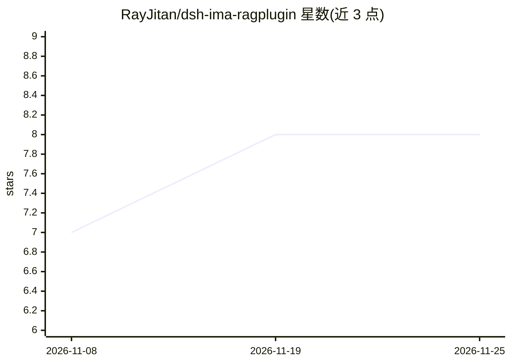

# RayJitan/dsh-ima-ragplugin

⭐ 8 · JavaScript · MIT · 推送 2026-11-06 · [GitHub](https://github.com/RayJitan/dsh-ima-ragplugin) · [官网](https://github.com/RayJitan/dsh-ima-ragplugin) · 个人维护 · 中文 README

**DSH 插件：把 IMA 知识库接入 DSH 供模型检索**

DeepSeek Harness（DSH）插件，将用户 IMA 账号可访问/已订阅的知识库接入 DSH：自动列出有权访问的库并在侧边栏勾选，注册 ima_kb_list / ima_kb_search / ima_kb_ask 三个原生工具，默认走返回原文片段的 search 路径，ask 仅作有损兜底；凭据走 DSH credential store，支持从 IMA 桌面客户端同步 cookie、token 过期自动刷新，并内置每日签到自动化。只读不写，依赖 IMA 内部 Web API。

## 筛选速览

| 维度 | 判定 | 备注 |
|---|---|---|
| AI 角色 | `ai-ecosystem` | LLM/agent 周边工具 |
| 许可风险 | `permissive` | MIT |
| 部署形态 | `None` |  |
| 模型依赖 | — | README 未给出锁定关系 |
| 硬件要求 | — | 无带数字的原话,不猜 |
| 安装摩擦 | `low` | 无编译、无系统依赖或容器化 |
| 成熟度 | — | 结构信号不足 |

## 能力要点

- 向 DSH 注册 3 个原生知识库检索工具，默认路径返回原文片段
- 无需手动填知识库 ID，自动列出可访问库并勾选为会话检索范围
- 凭据存于 DSH credential store，支持从 IMA 客户端 DPAPI 同步与 token 自动刷新
- IMA 每日签到福利后台自动化（补跑/幂等/限次）

## 适用场景

- 在 DSH 会话中直接检索自己订阅的 IMA 知识库原文
- 让模型基于个人知识库回答且拿到逐条出处
- 自动完成 IMA 每日签到领取算力

## 场景标签

`RAG` · 领域:知识与检索

## 证据(README 行号)

> L3: DeepSeek Harness（DSH）插件：把 IMA 账号里**可访问 / 已订阅的知识库**读出来，在侧边栏里勾选要接入的库，
> L14: 插件向 DSH 注册 3 个原生工具：
> L160: |项|要求|

## 星数曲线

2026-11-08 7 → 2026-11-25 8（+1）

---
*卡片 v1 · prompt 1.4 · 生成 2026-11-20 · 置信度 high · 依据 README sha `c598dc41b3b5` · [字段定义](../../DATASET.md)*
