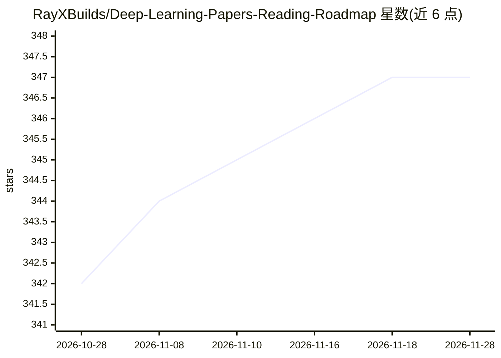

# RayXBuilds/Deep-Learning-Papers-Reading-Roadmap

⭐ 347 · Python · 推送 2026-11-27 · [GitHub](https://github.com/RayXBuilds/Deep-Learning-Papers-Reading-Roadmap) · 个人维护 · 中文 README

**深度学习论文中文精读与实验路线图**

面向已有 Python 与神经网络基础的学习者，按训练与视觉、序列与注意力、生成模型等路线组织论文阅读顺序。内容为 64 篇中文精读与 38 个机制实验专题，精读围绕动机、实现、证据与局限展开；配套实验仅需 Python 3.10+，可在 CPU 上运行并给出验收条件。语音、强化学习等方向标注为精读缺口。

## 筛选速览

| 维度 | 判定 | 备注 |
|---|---|---|
| AI 角色 | `ai-knowledge` | 知识聚合/清单类 |
| 许可风险 | `none` | — |
| 部署形态 | `None` |  |
| 模型依赖 | — | README 未给出锁定关系 |
| 硬件要求 | `cpu-ok` | |
| 安装摩擦 | `low` | 无编译、无系统依赖或容器化 |
| 成熟度 | — | 结构信号不足 |

## 能力要点

- 64 篇中文精读与 38 个机制实验专题，按 12 个专题组织
- 配套实验无需 GPU、第三方依赖或外部数据
- 提供技术关联图，标注方法间的继承、组件联系与对照关系
- 保留原论文 PDF，并支持旧路径到新位置的链接对照

## 适用场景

- 系统性地按路线精读深度学习经典论文
- 用 CPU 上可复现的小实验验证对论文机制的理解
- 按年份或专题检索论文原文与中文解读

## 场景标签

`教程课程` · 领域:学习与行业

## 证据(README 行号)

> L5: 从经典论文出发，理解深度学习中的关键问题、方法选择与技术演进。每篇中文精读围绕“为什么提出、怎样实现、证据是什么、局限在哪里”展开，部分论文配有可在 CPU 上运行的小实验。
> L29: 目前有 **64 篇精读初版、38 个机制实验专题**。从 AlexNet 开始可对照小核堆叠、多尺度分支与残差连接。从 word2vec 和 Seq2Seq 开始可追踪词向量、固定句向量与注意力之间的联系。

## 星数曲线

2026-10-28 342 → 2026-11-28 347（+5）

---
*卡片 v1 · prompt 1.4 · 生成 2026-11-28 · 置信度 high · 依据 README sha `c822dcb7c6cc` · [字段定义](../../DATASET.md)*
