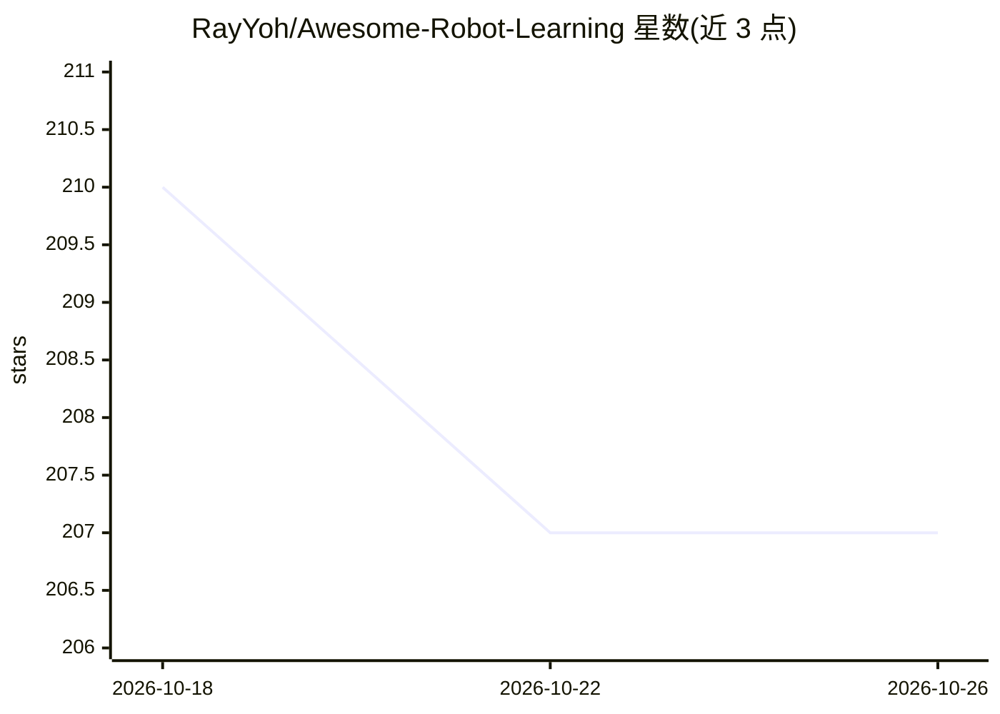

# RayYoh/Awesome-Robot-Learning

⭐ 207 · MIT · 推送 2026-08-20 · [GitHub](https://github.com/RayYoh/Awesome-Robot-Learning) · 个人维护

**机器人学习（侧重操作）研究资源策展清单**

面向机器人学习研究者的资源清单：收录综述论文、相关 awesome 清单、活跃实验室与研究者名录，并按 Isaac/MuJoCo/SAPIEN/PyBullet 等仿真平台分类整理操作类基准环境，另收录 Open X-Embodiment、D4RL、RH20T 等数据集。定位为节省研究者检索时间、聚焦自身算法，明确不收录具体研究论文（综述除外）。以 GitHub 清单形式维护，接受 PR 补充。

## 筛选速览

| 维度 | 判定 | 备注 |
|---|---|---|
| AI 角色 | `ai-knowledge` | 知识聚合/清单类 |
| 许可风险 | `permissive` | MIT |
| 部署形态 | `None` |  |
| 模型依赖 | — | README 未给出锁定关系 |
| 硬件要求 | — | 无带数字的原话,不猜 |
| 安装摩擦 | `low` | 无编译、无系统依赖或容器化 |
| 成熟度 | — | 结构信号不足 |

## 能力要点

- 按仿真平台（Isaac/MuJoCo/SAPIEN/PyBullet 等）分类整理操作类基准环境
- 收录实验室与活跃研究者名录（Berkeley/CMU/Stanford/清华等）
- 收录 Open X-Embodiment、D4RL、RH20T 等机器人学习数据集
- 整理 Embodied AI / VLA 相关综述论文表

## 适用场景

- 机器人操作方向选型仿真环境与基准
- 查找该领域活跃实验室与研究者
- 寻找机器人学习训练数据集

## 场景标签

`精选清单` · 领域:学习与行业

## 证据(README 行号)

> L6: This repo contains a curative list of **robot learning** (mainly for manipulation, which is also considered as a sub
> L8: **Motivation:** Robot learning, especially robot manipulation skills learning, is receiving more and more attention,

## 星数曲线

2026-10-18 210 → 2026-10-26 207（-3）

---
*卡片 v1 · prompt 1.4 · 生成 2026-10-22 · 置信度 high · 依据 README sha `129aab42e9b3` · [字段定义](../../DATASET.md)*
