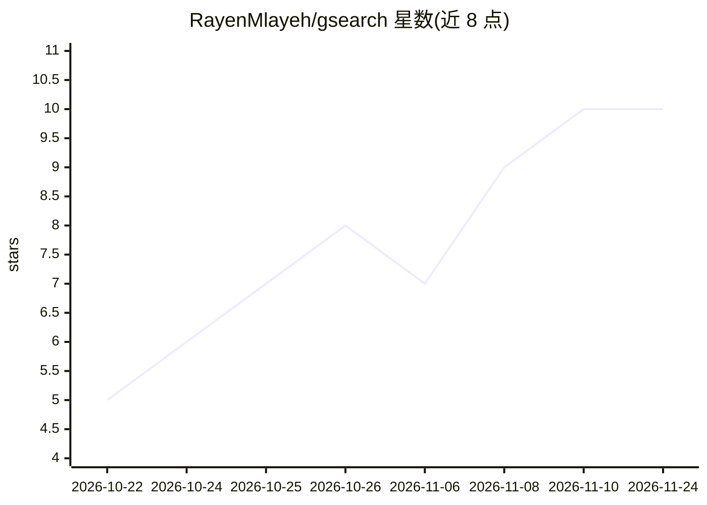

# RayenMlayeh/gsearch

⭐ 10 · Python · MIT · 推送 2026-11-03 · [GitHub](https://github.com/RayenMlayeh/gsearch) · 个人维护

**给 AI agent 提供真实 Google 搜索结果的 MCP 服务器**

自托管的 MCP 服务器：agent 调用 google_search 工具后，由 Camoufox（加固版 Firefox）在本机以真实浏览器渲染 Google 结果页，返回带类型的 JSON，含标题、摘要、真实 URL、AI Overview、People also ask、相关搜索、广告与分页。无需 API key；无代理时限制本机 IP 每小时 20 次搜索，支持任意格式代理、流量计量与硬限额；封禁以带 retry_after_s 的结构化错误返回，每个字符串标记为不可信网页内容。通过 uv/pipx 安装，Python 3.12+。

## 筛选速览

| 维度 | 判定 | 备注 |
|---|---|---|
| AI 角色 | `ai-ecosystem` | LLM/agent 周边工具 |
| 许可风险 | `permissive` | MIT |
| 部署形态 | `library` | 以包/库形式分发 |
| 模型依赖 | — | README 未给出锁定关系 |
| 硬件要求 | — | 无带数字的原话,不猜 |
| 安装摩擦 | `low` | 无编译、无系统依赖或容器化 |
| 成熟度 | — | 结构信号不足 |

## 能力要点

- 真实浏览器（Camoufox/Firefox）渲染 Google 结果页并输出类型化 JSON
- 无需 API key、自托管运行，支持任意格式代理与字节级流量限额
- 封禁/验证码以结构化错误返回并附重试时间，链接可解析为真实 URL
- 单 MCP 服务器提供搜索、页面读取（fetch_page/read_top）与链接解析工具

## 适用场景

- 让 Claude Desktop、Cursor 等 MCP 客户端里的 agent 搜索并引用真实 Google 结果
- 自建 agent 获取 AI Overview 与 People also ask 等结构化搜索数据
- 在服务器端通过代理池批量执行搜索并控制流量成本

## 场景标签

`网页抓取` · 领域:效率与自动化

## 证据(README 行号)

> L17:  Real Google Search for your AI agent. No API key. Self-hosted. Over MCP.
> L120: - 🤖 **Built for agents.** One MCP server: search, page reading and status, typed JSON. Blocks come back as clear e

## 星数曲线

2026-10-22 5 → 2026-11-24 10（+5）

---
*卡片 v1 · prompt 1.4 · 生成 2026-11-20 · 置信度 high · 依据 README sha `df8cc581507a` · [字段定义](../../DATASET.md)*
