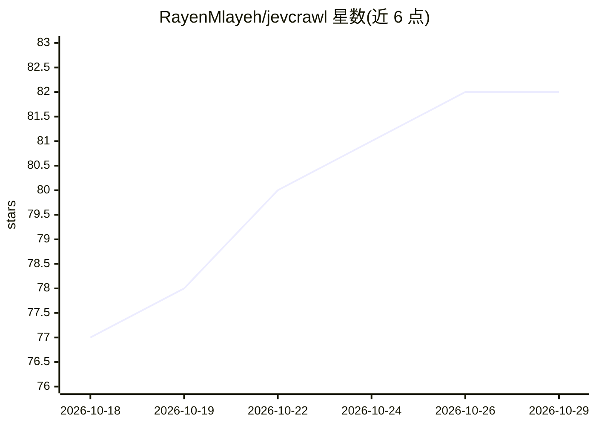

# RayenMlayeh/jevcrawl

⭐ 82 · Python · Apache-2.0 · 推送 2026-10-26 · [GitHub](https://github.com/RayenMlayeh/jevcrawl) · 个人维护

**面向 AI agent 的 MCP 网页爬取服务器与 CLI：定位答案页**

以 MCP server 与 CLI 形式提供的网页爬取工具，供 Claude Code、Claude Desktop、Cursor 等 MCP 客户端的 agent 调用。核心机制：小型决策模型 Jev 对每个链接与段落打分，仅返回与问题相关的原文段落（附 URL、标题路径与字符偏移），决策模型只打分不生成文本。提供 crawl/scrape/map 三个工具，需 Jev API key（typesafe.ai）方可使用，页面文本会发送至 TypeSafe 评分。支持可选 JavaScript 渲染（Chromium）、本地结果缓存、robots.txt 默认遵循。README 附带与 Crawl4AI 及 Claude 逐链接选择的基准测试，样本为 50 与 20 个任务。Apache-2.0 许可。

## 筛选速览

| 维度 | 判定 | 备注 |
|---|---|---|
| AI 角色 | `ai-ecosystem` | LLM/agent 周边工具 |
| 许可风险 | `permissive` | Apache-2.0 |
| 部署形态 | `library` | 以包/库形式分发 |
| 模型依赖 | — | README 未给出锁定关系 |
| 硬件要求 | — | 无带数字的原话,不猜 |
| 安装摩擦 | `low` | 无编译、无系统依赖或容器化 |
| 成熟度 | — | 结构信号不足 |

## 能力要点

- Jev 决策模型对链接与段落打分，仅返回相关原文段落（附 URL 与字符偏移）
- 以 MCP server 与 CLI 两种形式提供，兼容 Claude Code / Claude Desktop / Cursor
- 页面文本仅作数据评分不作指令，决策模型无法生成文本
- 本地缓存重复目标零成本，max_decision_usd 硬性预算限制

## 适用场景

- 让我的 agent 在大型文档站点中定位答案页并只读相关段落
- 为 RAG/问答流程提供带出处的定向网页抓取
- 控制 agent 浏览网页时的 token 与成本开销

## 场景标签

`网页抓取` · 领域:效率与自动化

## 证据(README 行号)

> L3: ### The web crawler for AI agents that finds the answer, not just pages.
> L36: - 🔌 **Works everywhere MCP does:** Claude Code, Claude Desktop, Cursor, or the CLI.
> L46: claude mcp add jevcrawl -e TYPESAFE_API_KEY=<your key> -- uvx jevcrawl

## 星数曲线

2026-10-18 77 → 2026-10-29 82（+5）

---
*卡片 v1 · prompt 1.4 · 生成 2026-10-24 · 置信度 high · 依据 README sha `a3d45e20baec` · [字段定义](../../DATASET.md)*
