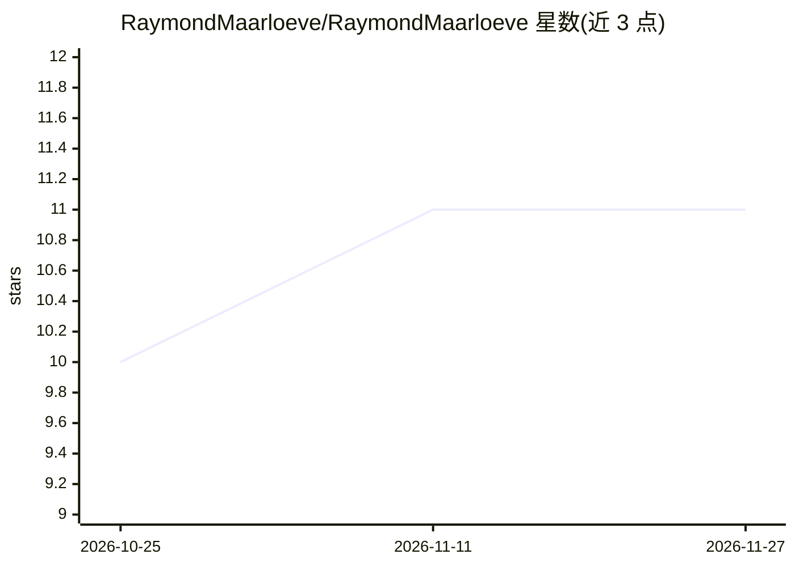

# RaymondMaarloeve/RaymondMaarloeve

⭐ 11 · C# · 推送 2026-01-12 · [GitHub](https://github.com/RaymondMaarloeve/RaymondMaarloeve) · 组织维护

**LLM 驱动 NPC 的侦探推理游戏**

基于 Unity 6 与 C# 开发的侦探题材电脑游戏：NPC 拥有独立个性与日程安排，其对话与决策由 Llama 3.2 3B Instruct 模型驱动，事件不依赖固定脚本，由 NPC 与玩家的交互推动案情发展。游戏提供独立 Launcher 仓库用于启动与下载模型，并单独维护负责 LLM 处理的 LLMServer 仓库；支持 Windows 与 Linux 运行。规划中的内容包括蒸馏更小的专用模型、改进叙事者模型，以及让玩家通过对话说服 LLM 指认凶手的终局玩法。

## 筛选速览

| 维度 | 判定 | 备注 |
|---|---|---|
| AI 角色 | `ai-native` | 本体是模型或模型工具 |
| 许可风险 | `none` | — |
| 部署形态 | `None` |  |
| 模型依赖 | — | README 未给出锁定关系 |
| 硬件要求 | — | 无带数字的原话,不猜 |
| 安装摩擦 | `low` | 无编译、无系统依赖或容器化 |
| 成熟度 | — | 结构信号不足 |

## 能力要点

- NPC 对话与决策由 Llama 3.2 3B Instruct 驱动
- 事件无固定脚本，NPC 行为影响剧情走向
- 独立 Launcher 与 LLMServer 仓库分别处理启动与 LLM 服务
- 支持 Windows 与 Linux 平台

## 适用场景

- 玩一场每局 NPC 行为都不同的侦探推理游戏
- 研究 LLM 驱动 NPC 在游戏中的实现方式
- 体验通过对话指认凶手的终局推理玩法

## 场景标签

`聊天机器人` · 领域:对话与助手

## 证据(README 行号)

> L25: The project we are working on is a computer game in which artificial intelligence (AI) plays a key role. Its main f
> L35:  - We use **Llama 3.2 3B Instruct** for all in-game LLM-driven behaviors, including NPC dialogue and decision-makin

## 星数曲线

2026-10-25 10 → 2026-11-27 11（+1）

---
*卡片 v1 · prompt 1.4 · 生成 2026-11-18 · 置信度 high · 依据 README sha `64bec4b8cd7b` · [字段定义](../../DATASET.md)*
