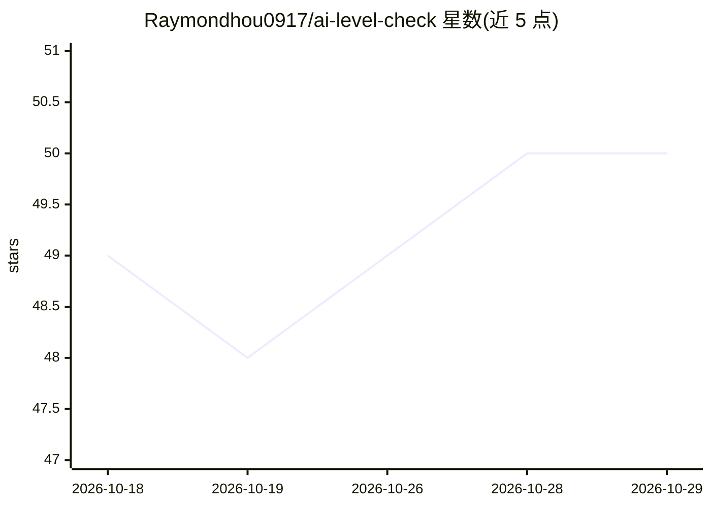

# Raymondhou0917/ai-level-check

⭐ 50 · Python · MIT · 推送 2026-09-18 · [GitHub](https://github.com/Raymondhou0917/ai-level-check) · [官网](https://ai.lifehacker.tw/reports/ai-level-check-demo/) · 个人维护 · 中文 README

**讀本機 AI agent 紀錄、產出 LV0–LV5 使用能力報告的 skill**

以 SKILL.md 形式提供給 Claude Code、Codex、Cursor 等 agent 使用的評估工具：掃描硬碟上已有的 agent 對話紀錄，區分 human／automation／subagent 三類訊息，依判準產出 LV0–LV5 使用等級、四項系統驗證、16 型人物志與單檔 HTML 報告；也提供純貼 Prompt 的網頁版路徑（最多到 LV3）。collect.py 僅用 Python 標準庫、不連網；規則中明定不排名、不遠端集中掃描、不能單獨作為考績或錄用依據。

## 筛选速览

| 维度 | 判定 | 备注 |
|---|---|---|
| AI 角色 | `ai-ecosystem` | LLM/agent 周边工具 |
| 许可风险 | `permissive` | MIT |
| 部署形态 | `None` |  |
| 模型依赖 | — | README 未给出锁定关系 |
| 硬件要求 | — | 无带数字的原话,不猜 |
| 安装摩擦 | `low` | 无编译、无系统依赖或容器化 |
| 成熟度 | — | 结构信号不足 |

## 能力要点

- 掃 Claude Code、Codex、Antigravity 本機紀錄並產出可追溯報告
- 人機分流：human／automation／subagent 三類訊息分開判讀
- LV0–LV5 等級＋四項系統驗證＋16 型人物志
- collect.py 純標準庫、不連網，支援 --no-content 與遮罩模式

## 适用场景

- 面試時請候選人在自己電腦跑報告並螢幕分享
- 主管了解團隊成員實際 AI 使用方式（自願制）
- 課程學員檢視自己 14 天的 AI 使用紀錄

## 场景标签

 · 领域:AI 使用評估/生產力工具

## 证据(README 行号)

> L24: 掃 Claude Code、Codex、Antigravity 留在硬碟上的紀錄，
> L30: 給 Claude Code、Codex、Cursor 和任何能讀 Markdown 的 AI agent 用。
> L61: Claude Code、Codex、Cursor、Antigravity：把 skill 裝進去，對它說「幫我跑這兩週的 AI 使用檢核」。它在你這台電腦掃紀錄、寫報告。

## 星数曲线

2026-10-18 49 → 2026-10-29 50（+1）

---
*卡片 v1 · prompt 1.4 · 生成 2026-10-25 · 置信度 high · 依据 README sha `27d5bbc09f7b` · [字段定义](../../DATASET.md)*
