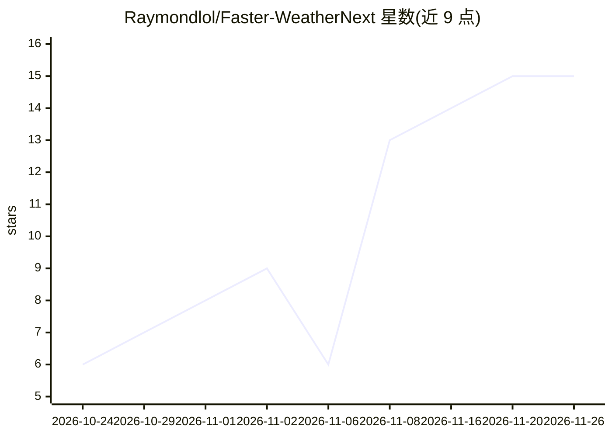

# Raymondlol/Faster-WeatherNext

⭐ 15 · Python · Apache-2.0 · 推送 2026-11-02 · [GitHub](https://github.com/Raymondlol/Faster-WeatherNext) · 个人维护

**在消费级 GPU 上以 0.25° 运行 WeatherNext 2 天气集合预报**

运行时补丁库：不修改官方 WeatherNext 2 代码与权重，通过 enable() 替换模块实现，用 Pallas/Triton 融合注意力内核与分块图网络，将单步显存从约 34 GiB 降至 6.4 GiB、速度提升，使 8 GB 显卡可跑完整 0.25° 分辨率。数值结果与官方实现一致到浮点舍入水平。提供 fwn CLI 从 ECMWF 开放数据取初始场并输出 NetCDF，含实验性单卡微调；需 Python 3.12 与 CUDA 12/13 驱动，非 Google 官方项目。

## 筛选速览

| 维度 | 判定 | 备注 |
|---|---|---|
| AI 角色 | `ai-native` | 本体是模型或模型工具 |
| 许可风险 | `permissive` | Apache-2.0 |
| 部署形态 | `library` | 以包/库形式分发 |
| 模型依赖 | — | README 未给出锁定关系 |
| 硬件要求 | — | 无带数字的原话,不猜 |
| 安装摩擦 | `medium` | 含编译或系统依赖之一 |
| 成熟度 | — | 结构信号不足 |

## 能力要点

- 运行时补丁：一行 enable() 调用，官方代码与检查点不变，fp32 相关系数 0.9999999998
- 8 GB 消费级显卡（RTX 4060）可运行完整 0.25° 分辨率，RTX 5090 单步 0.78 s
- fwn forecast 命令拉取 ECMWF 开放数据初始场并写出 NetCDF
- 实验性单卡微调：head（5.6M 参数）可在 24 GB 卡上训练

## 适用场景

- 在没有数据中心 GPU 的条件下生成 10 天集合天气预报
- 已使用官方 WeatherNext 2 代码的项目通过补丁降低显存与耗时
- 基于 ECMWF 开放数据在单卡上做气象模型微调实验

## 场景标签

`推理引擎` `微调` · 领域:训练与推理

## 证据(README 行号)

> L25: **faster-weathernext** patches the official code at run time so the *same* model runs on a gaming GPU. Nothing is a
> L30: - **Small.** Full 0.25° resolution in ~6.4 GiB — **runs on 8 GB cards** like the RTX 4060.
> L31: - **Fast.** 0.78 s per 6-hour step on an RTX 5090: **a 10-day forecast in ~31 seconds** per ensemble member.

## 星数曲线

2026-10-24 6 → 2026-11-26 15（+9）

---
*卡片 v1 · prompt 1.4 · 生成 2026-11-18 · 置信度 high · 依据 README sha `cb320884c2f1` · [字段定义](../../DATASET.md)*
