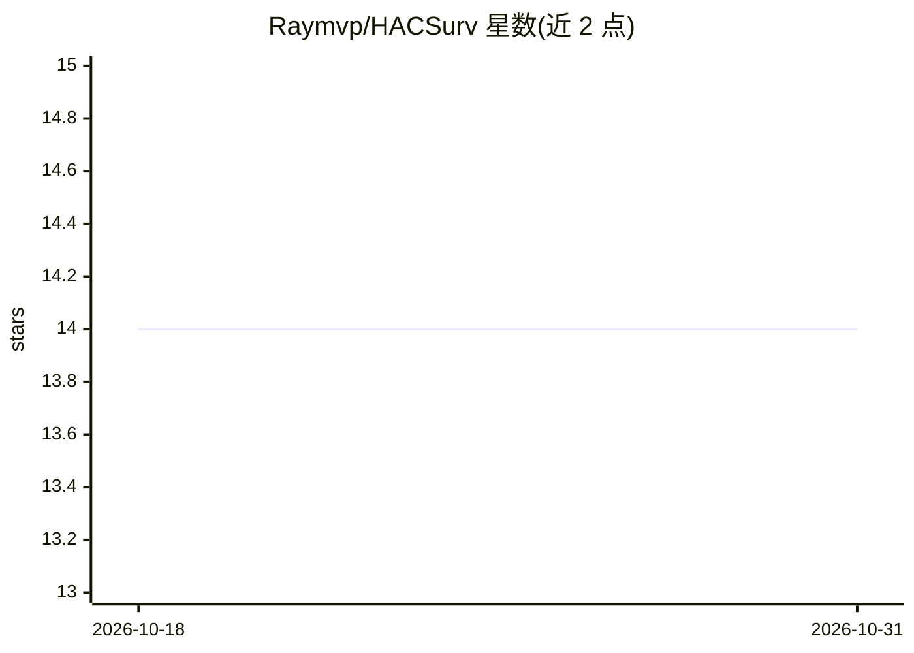

# Raymvp/HACSurv

⭐ 14 · Jupyter Notebook · 推送 2026-06-06 · [GitHub](https://github.com/Raymvp/HACSurv) · 个人维护

**AISTATS 2025 论文 HACSurv 的 PyTorch 实现：依赖竞争风险的生存分析**

论文《HACSurv: A Hierarchical Copula-Based Approach for Survival Analysis with Dependent Competing Risks》(AISTATS 2025) 的官方 PyTorch 代码。方法分两步：先学习事件对之间的层次 Archimedean Copula（选最强为内层、最弱为外层），再在其上做生存分析建模。提供 Frahamingham、合成数据与 MIMIC-III 三组实验的复现脚本，覆盖 HACSurv、对称变体与独立基线三种设置，并附 BibTeX 引用。以脚本与 notebook 形式运行，未提供打包安装方式。

## 筛选速览

| 维度 | 判定 | 备注 |
|---|---|---|
| AI 角色 | `ai-native` | 本体是模型或模型工具 |
| 许可风险 | `none` | — |
| 部署形态 | `None` |  |
| 模型依赖 | — | README 未给出锁定关系 |
| 硬件要求 | — | 无带数字的原话,不猜 |
| 安装摩擦 | `low` | 无编译、无系统依赖或容器化 |
| 成熟度 | — | 结构信号不足 |

## 能力要点

- 两阶段方法：先学层次 Archimedean Copula 结构，再做生存分析
- 支持对称（Symmetry）与独立（Independent）基线对比实验
- 覆盖 Framingham、合成数据、MIMIC-III 三个数据集的复现脚本

## 适用场景

- 复现 AISTATS 2025 论文实验结果
- 在 EHR 数据（如 MIMIC-III）上做依赖竞争风险生存分析研究
- 学习事件依赖结构（copula）用于生存建模

## 场景标签

 · 领域:机器学习/生存分析

## 证据(README 行号)

> L3: **PyTorch implementation for the paper:** HACSurv: A Hierarchical Copula-Based Approach for Survival Analysis with D
> L43: ## 3. MIMIC-III Dataset

## 星数曲线

2026-10-18 14 → 2026-10-31 14（+0）

---
*卡片 v1 · prompt 1.4 · 生成 2026-10-31 · 置信度 high · 依据 README sha `48078783d728` · [字段定义](../../DATASET.md)*
