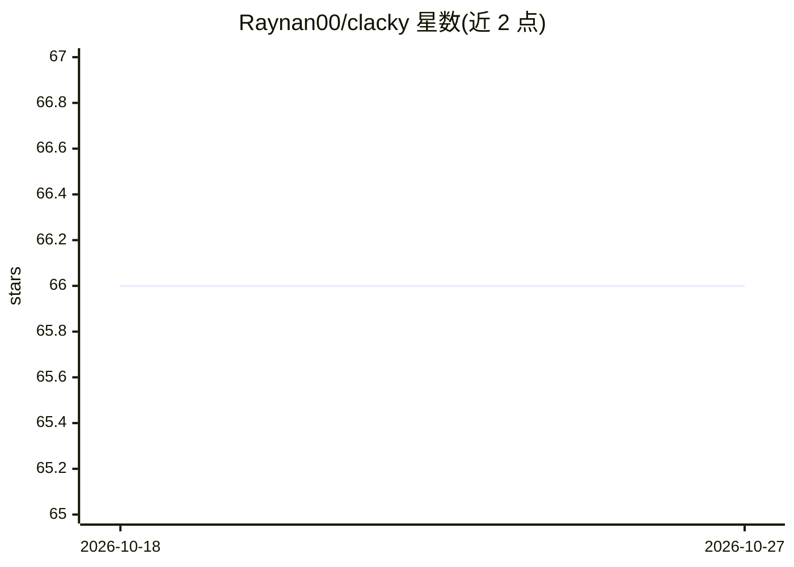

# Raynan00/clacky

⭐ 66 · Python · NOASSERTION · 推送 2026-07-10 · [GitHub](https://github.com/Raynan00/clacky) · 个人维护

**Windows 语音桌面 AI 伙伴：看屏幕、指向并代操作**

面向 Windows 用户的语音优先桌面伴侣应用：按住热键说话后，它读取屏幕内容回答问题，屏幕上的小角色会飞行并像素级对齐指向相关 UI 元素，并通过 Claude Computer Use 执行打开应用、点击、输入、多步任务等操作；支持跨会话记忆、语音教学例程、SKILL.md 技能文件与后台研究代理（可连接 MCP 服务器）。语音链路为 Deepgram 流式 STT 与 Edge TTS，无 Deepgram key 时回退本地 Whisper。另附文件整理命令（仅移动、可撤销）。需自备 Anthropic API key；README 自述为早期构建。

## 筛选速览

| 维度 | 判定 | 备注 |
|---|---|---|
| AI 角色 | `ai-native` | 本体是模型或模型工具 |
| 许可风险 | `none` | NOASSERTION |
| 部署形态 | `desktop` | 安装包/桌面程序 |
| 模型依赖 | locked-api |  |
| 硬件要求 | — | 无带数字的原话,不猜 |
| 安装摩擦 | `low` | 无编译、无系统依赖或容器化 |
| 成熟度 | `idea` | |

## 能力要点

- Claude Computer Use 驱动的屏幕理解与本机操作（点击/输入/多步任务）
- 像素级 UI 元素指向与屏幕讲解导览
- 跨会话记忆、语音教学例程与 SKILL.md 技能系统
- 后台研究代理可连接任意 MCP 服务器并产出真实文件

## 适用场景

- 用语音让 AI 看我的屏幕并回答相关问题
- 让 AI 代为操作电脑：打开应用、点击、输入
- 口述偏好让 AI 记住，并教它例行任务
- 一条命令整理文件夹且可完全撤销

## 场景标签

`GUI 自动化` `语音 Agent` `AI 助手` · 领域:效率与自动化

## 证据(README 行号)

> L11: - **acts** — opens apps, clicks, types, runs multi-step tasks, using Claude Computer Use,
> L15: Her brain is **Claude** (Sonnet 5 + Computer Use); voice via **Deepgram** streaming STT and free **Edge TTS**.

## 星数曲线

2026-10-18 66 → 2026-10-27 66（+0）

---
*卡片 v1 · prompt 1.4 · 生成 2026-10-24 · 置信度 high · 依据 README sha `16a6ba24a2a2` · [字段定义](../../DATASET.md)*
