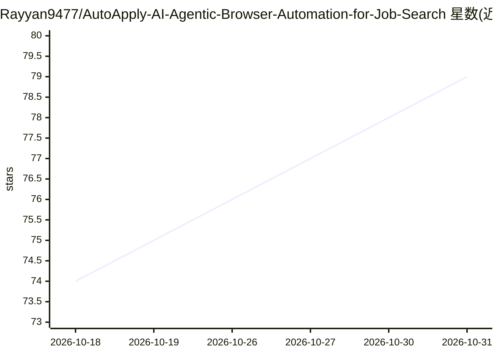

# Rayyan9477/AutoApply-AI-Agentic-Browser-Automation-for-Job-Search

⭐ 79 · Python · 推送 2026-08-04 · [GitHub](https://github.com/Rayyan9477/AutoApply-AI-Agentic-Browser-Automation-for-Job-Search) · 个人维护

**求职自动化全栈平台：AI 定制简历并跟踪投递**

FastAPI + React 的全栈求职工作流平台：从 LinkedIn、Indeed、Glassdoor 与 Exa AI 语义搜索发现职位，基于 LLM 做简历内容优化与 PDF/DOCX 生成，通过 browser-use + Playwright 执行平台化投递，并提供申请状态跟踪、审批流、漏斗分析与 LLM 用量监控。LLM 接入经 LiteLLM + Portkey 网关，支持 OpenAI、Groq、Gemini、OpenRouter。README 的 Current Status 标注 LinkedIn/Indeed/Glassdoor 爬虫、自动投递、LLM 简历生成管道仍为 In Progress。提供 Docker Compose 与本地开发两种安装路径。

## 筛选速览

| 维度 | 判定 | 备注 |
|---|---|---|
| AI 角色 | `ai-native` | 本体是模型或模型工具 |
| 许可风险 | `none` | — |
| 部署形态 | `self-host` | docker 或自建部署 |
| 模型依赖 | locked-api |  |
| 硬件要求 | — | 无带数字的原话,不猜 |
| 安装摩擦 | `low` | 无编译、无系统依赖或容器化 |
| 成熟度 | `idea` | |

## 能力要点

- 多平台职位发现（LinkedIn/Indeed/Glassdoor/Exa AI 语义搜索）
- 多因子 ATS 评分（技能、关键词、经验、教育）
- browser-use + Playwright 浏览器自动化投递，支持 review/autonomous/batch 三种模式
- LiteLLM + Portkey 网关接入 OpenAI、Groq、Gemini、OpenRouter

## 适用场景

- 集中管理职位发现、简历定制与投递跟踪
- 按职位自动定制简历并生成 ATS 友好文档
- 通过仪表盘查看投递漏斗与 ATS 分数分布

## 场景标签

`浏览器自动化` `网页抓取` `AI 写作` · 领域:效率与自动化

## 证据(README 行号)

> L14: - **Resume Tailoring** with LLM-powered content optimization and PDF/DOCX generation
> L31: - **AI:** LiteLLM + Portkey gateway with OpenAI, Groq, Gemini, OpenRouter support

## 星数曲线

2026-10-18 74 → 2026-10-31 79（+5）

---
*卡片 v1 · prompt 1.4 · 生成 2026-10-24 · 置信度 high · 依据 README sha `9a3c916d042d` · [字段定义](../../DATASET.md)*
