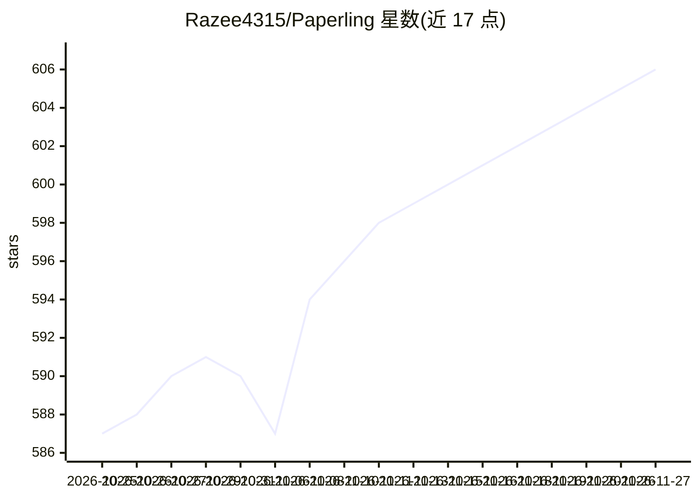

# Razee4315/Paperling

⭐ 606 · TypeScript · Apache-2.0 · 推送 2026-11-26 · [GitHub](https://github.com/Razee4315/Paperling) · [官网](https://razee4315.github.io/Paperling/) · 个人维护

**给写作者的免配置 Markdown 阅读编辑器，带可选 AI 修改建议**

基于 Tauri、React、TypeScript 构建的桌面 Markdown 阅读与编辑器：打开 .md 即可阅读，支持阅读/代码/分栏三视图、实时预览（KaTeX 数学、mhchem 化学、Mermaid 图表）、斜杠命令、多光标、表格可视化编辑、文件历史与崩溃恢复。AI 部分为可选功能：侧栏聊天（提问模式）与 Agent 模式以行内 diff 提出修改，用户逐条接受或拒绝；支持任意 OpenAI 兼容端点，API key 存于系统钥匙串。提供 Windows/macOS/Linux/Android 安装包，安装包尚未代码签名。

## 筛选速览

| 维度 | 判定 | 备注 |
|---|---|---|
| AI 角色 | `ai-enhanced` | 去掉 AI 部分产品仍成立 |
| 许可风险 | `permissive` | Apache-2.0 |
| 部署形态 | `desktop` | 安装包/桌面程序 |
| 模型依赖 | local-ok | 支持本地模型 |
| 硬件要求 | — | 无带数字的原话,不猜 |
| 安装摩擦 | `low` | 无编译、无系统依赖或容器化 |
| 成熟度 | — | 结构信号不足 |

## 能力要点

- 阅读/代码/分栏视图与双向滚动同步
- KaTeX 数学、mhchem 化学方程式、Mermaid 图表实时渲染
- Agent 模式以行内 diff 提出编辑，逐条接受或拒绝
- 兼容任意 OpenAI 端点（含 Ollama、llama.cpp），key 存系统钥匙串

## 适用场景

- 打开本地 .md 文档直接阅读和编辑，无需配置 vault 或插件
- 写带公式、化学方程式和图表的笔记
- 让 AI 以 diff 形式提议文本修改，人工确认后落盘
- 在 Windows/macOS/Linux/Android 上跨平台使用同一编辑器

## 场景标签

`AI 写作` · 领域:内容生成

## 证据(README 行号)

> L6:  A no-setup Markdown reader and editor. Open any <code>.md</code> file and read it beautifully, edit with live previ
> L32: I wanted something you just open and write in: it renders Markdown beautifully while keeping the raw text one keyst
> L99: - **Agent mode** — describe a change in plain language and the AI proposes edits. They appear as an **inline diff i

## 星数曲线

2026-10-25 587 → 2026-11-27 606（+19）

---
*卡片 v1 · prompt 1.4 · 生成 2026-11-27 · 置信度 high · 依据 README sha `e6e4116137c1` · [字段定义](../../DATASET.md)*
