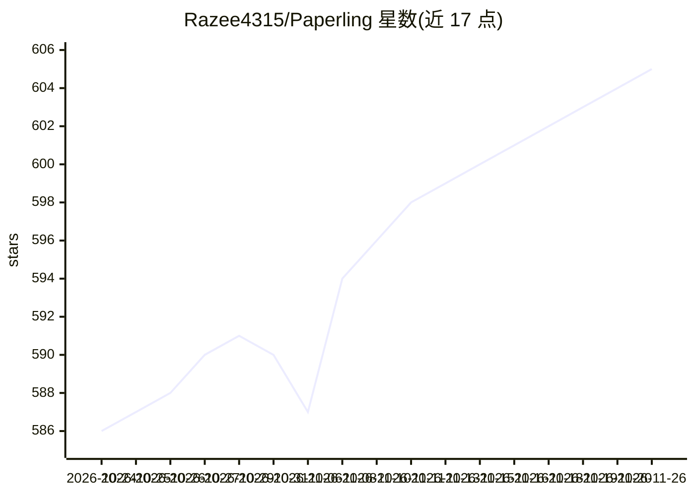

# Razee4315/Paperling

⭐ 605 · TypeScript · Apache-2.0 · 推送 2026-11-23 · [GitHub](https://github.com/Razee4315/Paperling) · [官网](https://razee4315.github.io/Paperling/) · 个人维护

**免配置的 Markdown 阅读编辑器，带可选用 AI 编辑**

基于 Tauri/React/TypeScript 的桌面 Markdown 应用，打开任意 .md 即读即编：分屏实时预览（KaTeX 数学、mhchem 化学、Mermaid 图表、GFM）、文件浏览器、命令面板、文件历史与崩溃恢复。AI 为可选项：侧栏问答与 Agent 模式以行内 diff 提议编辑，用户逐项接受或拒绝；自带模型接入任意 OpenAI 兼容端点，API key 存于系统钥匙串。提供 Windows/macOS/Linux/Android 安装包，构建未签名，macOS 需手动放行。

## 筛选速览

| 维度 | 判定 | 备注 |
|---|---|---|
| AI 角色 | `ai-enhanced` | 去掉 AI 部分产品仍成立 |
| 许可风险 | `permissive` | Apache-2.0 |
| 部署形态 | `desktop` | 安装包/桌面程序 |
| 模型依赖 | local-ok | 支持本地模型 |
| 硬件要求 | — | 无带数字的原话,不猜 |
| 安装摩擦 | `low` | 无编译、无系统依赖或容器化 |
| 成熟度 | — | 结构信号不足 |

## 能力要点

- 分屏实时预览：KaTeX 数学、mhchem 化学、Mermaid 图表
- Agent 模式以行内 diff 提议编辑，接受或拒绝后才写入
- OpenAI 兼容端点自由接入（OpenAI/Gemini/Ollama/llama.cpp）
- 文件历史（30 天）与崩溃恢复、外部变更检测

## 适用场景

- 快速打开并阅读 .md 文件而非在记事本中看源码
- 写带数学、化学、图表的笔记且边写边渲染
- 用自然语言让 AI 提议改写并逐条审阅接受

## 场景标签

 · 领域:开发工具/笔记与编辑器

## 证据(README 行号)

> L6:  A no-setup Markdown reader and editor. Open any <code>.md</code> file and read it beautifully, edit with live previ
> L99: - **Agent mode** — describe a change in plain language and the AI proposes edits. They appear as an **inline diff i
> L101: - **Bring your own model** — works with any OpenAI-compatible endpoint: OpenAI, Google Gemini (OpenAI-compat), Oll

## 星数曲线

2026-10-24 586 → 2026-11-26 605（+19）

---
*卡片 v1 · prompt 1.4 · 生成 2026-11-25 · 置信度 high · 依据 README sha `8a8f6d725c3c` · [字段定义](../../DATASET.md)*
