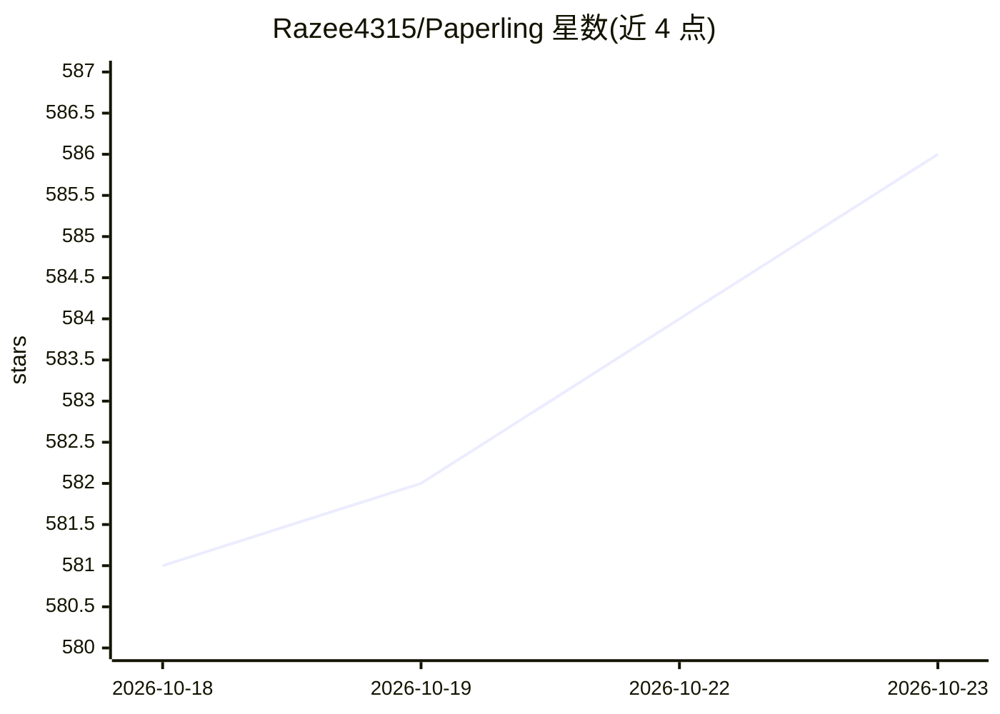

# Razee4315/Paperling

⭐ 586 · TypeScript · Apache-2.0 · 推送 2026-10-19 · [GitHub](https://github.com/Razee4315/Paperling) · [官网](https://razee4315.github.io/Paperling/) · 个人维护

**免配置的 Markdown 阅读编辑器，内置可选 AI 改稿助手**

基于 Tauri/React/TypeScript 的跨平台 Markdown 编辑器，主打打开即用：实时渲染预览（KaTeX 数学、mhchem 化学、Mermaid 图表、GFM）、分屏双向滚动同步、多光标、可视化表格编辑、wikilink 与反向链接等。AI 为可选功能：侧边 AI 面板支持对话问答与 Agent 模式，以行内 diff 形式提出编辑建议，逐条或整体接受/拒绝；接入任意 OpenAI 兼容端点（OpenAI、Gemini、Ollama、llama.cpp 等），API key 存于系统钥匙串。无 vault 与插件体系，构建未签名需手动放行。

## 筛选速览

| 维度 | 判定 | 备注 |
|---|---|---|
| AI 角色 | `ai-enhanced` | 去掉 AI 部分产品仍成立 |
| 许可风险 | `permissive` | Apache-2.0 |
| 部署形态 | `desktop` | 安装包/桌面程序 |
| 模型依赖 | local-ok | 支持本地模型 |
| 硬件要求 | — | 无带数字的原话,不猜 |
| 安装摩擦 | `low` | 无编译、无系统依赖或容器化 |
| 成熟度 | — | 结构信号不足 |

## 能力要点

- Agent 模式以行内 diff 提出编辑建议，逐条接受/拒绝
- 接入任意 OpenAI 兼容端点（含 Ollama、llama.cpp），key 存于 OS 钥匙串
- 实时渲染数学（KaTeX）、化学（mhchem）、Mermaid 图表
- 选中文本就地改写/续写/翻译（Alt+J / ⌘J）

## 适用场景

- 日常打开和编辑 .md 文档、笔记与项目 README
- 写技术文档时实时预览公式、化学反应式与流程图
- 让 AI 建议改稿并逐条审核后写入

## 场景标签

`AI 写作` · 领域:内容生成

## 证据(README 行号)

> L6:  A no-setup Markdown reader and editor. Open any <code>.md</code> file and read it beautifully, edit with live previ
> L32: I wanted something you just open and write in: it renders Markdown beautifully while keeping the raw text one keyst
> L95: - **Agent mode** — describe a change in plain language and the AI proposes edits. They appear as an **inline diff i

## 星数曲线

2026-10-18 581 → 2026-10-23 586（+5）

---
*卡片 v1 · prompt 1.4 · 生成 2026-10-21 · 置信度 high · 依据 README sha `3b912b6f2885` · [字段定义](../../DATASET.md)*
