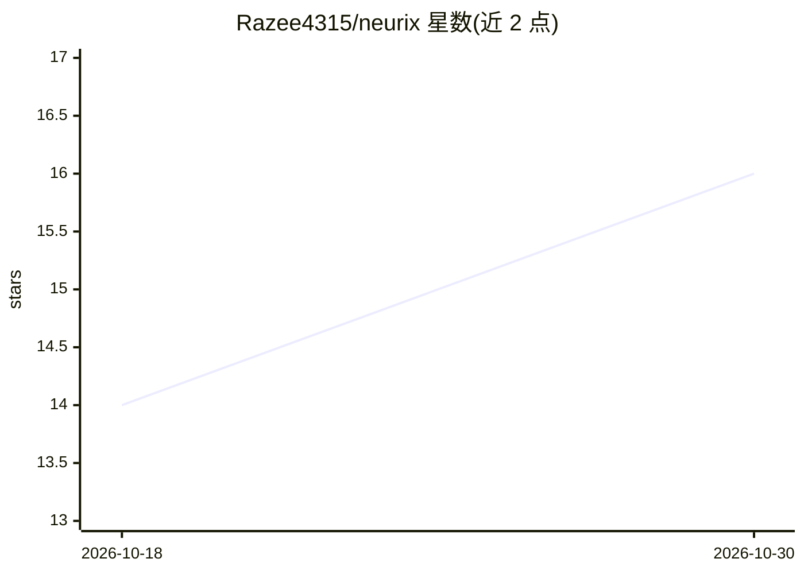

# Razee4315/neurix

⭐ 16 · TypeScript · MIT · 推送 2026-10-29 · [GitHub](https://github.com/Razee4315/neurix) · [官网](https://razee4315.github.io/neurix/) · 个人维护

**手机/桌面离线运行本地大模型的聊天应用**

基于 Tauri 2（Rust + llama.cpp 后端，React 前端）的端侧 AI 聊天应用，同一代码支持 Windows 与 Android，macOS/Linux 需从源码构建。模型下载一次后完全离线运行于 CPU，内置模型商店提供 Qwen 3.5、LFM 2.5、Gemma 4 等 0.8B–4B 小模型（640 MB–5.2 GB），支持任意 GGUF 模型添加、推理模式、角色与 Friends 人格、本地文件夹/GitHub/Gmail 只读连接器、备份导出。会话不离开设备。

## 筛选速览

| 维度 | 判定 | 备注 |
|---|---|---|
| AI 角色 | `ai-native` | 本体是模型或模型工具 |
| 许可风险 | `permissive` | MIT |
| 部署形态 | `desktop` | 安装包/桌面程序 |
| 模型依赖 | local-ok | 支持本地模型 |
| 硬件要求 | — | 无带数字的原话,不猜 |
| 安装摩擦 | `low` | 无编译、无系统依赖或容器化 |
| 成熟度 | `idea` | |

## 能力要点

- llama.cpp CPU 推理，下载后完全离线运行
- 模型商店按设备内存推荐模型并提示放不下
- 支持任意 llama.cpp 兼容的 GGUF 模型
- 连接器只读 GitHub/Gmail/本地文件，按问题匹配片段

## 适用场景

- 无网络环境（旅行、偏远地区、航班）使用 AI 助手
- 手机或电脑上完全私有地运行本地 LLM 聊天
- 创建自定义 AI 朋友/角色进行对话

## 场景标签

`AI 助手` · 领域:对话与助手

## 证据(README 行号)

> L37: Neurix runs large language models entirely on your computer or phone. No server, no API calls, no internet required
> L78: - **On-device inference**: AI runs on your CPU through llama.cpp, no server involved

## 星数曲线

2026-10-18 14 → 2026-10-30 16（+2）

---
*卡片 v1 · prompt 1.4 · 生成 2026-10-30 · 置信度 high · 依据 README sha `e844a3bbb0e8` · [字段定义](../../DATASET.md)*
