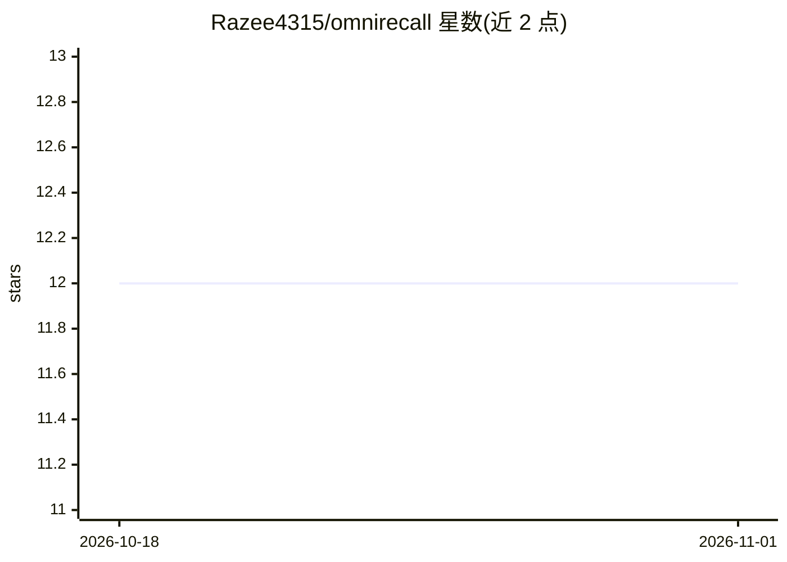

# Razee4315/omnirecall

⭐ 12 · TypeScript · NOASSERTION · 推送 2026-10-10 · [GitHub](https://github.com/Razee4315/omnirecall) · [官网](https://razee4315.github.io/omnirecall/) · 个人维护

**桌面 AI 知识助手：快捷键唤起，基于本地文档问答**

基于 Tauri（Node.js + Rust）构建的轻量级桌面应用，常驻后台，通过快捷键在光标处以 Spotlight 风格浮窗唤起 AI 对话。支持 Gemini、OpenAI、Claude、GLM、Ollama 等多种提供方；可将 PDF、文本、Markdown、代码文件加入本地持久存储并基于文档上下文问答，回答会列出引用的文档；设置 Gemini API key 后大文档会被索引用于搜索。提供 Windows/Linux 安装包，macOS 支持列为计划中。采用 Source Available 许可。

## 筛选速览

| 维度 | 判定 | 备注 |
|---|---|---|
| AI 角色 | `ai-native` | 本体是模型或模型工具 |
| 许可风险 | `none` | NOASSERTION |
| 部署形态 | `desktop` | 安装包/桌面程序 |
| 模型依赖 | local-ok | 支持本地模型 |
| 硬件要求 | — | 无带数字的原话,不猜 |
| 安装摩擦 | `low` | 无编译、无系统依赖或容器化 |
| 成熟度 | — | 结构信号不足 |

## 能力要点

- 光标处快捷键唤起的 Spotlight 式 AI 浮窗
- 支持 Gemini、OpenAI、Claude、GLM、Ollama 五种提供方
- PDF/TXT/Markdown/代码的本地持久存储与基于文档的问答
- 隐私优先、本地优先设计，答案列出所引用文档

## 适用场景

- 工作中不切浏览器，快捷键快速向 AI 提问
- 把 PDF 或代码文档加入应用后基于其内容问答
- 通过 Ollama 接入完全本地模型使用

## 场景标签

`聊天机器人` `文档问答` `AI 助手` · 领域:对话与助手

## 证据(README 行号)

> L5: **AI-powered desktop knowledge assistant**
> L34: - Multiple AI providers: Gemini, OpenAI, Claude, GLM, Ollama
> L35: - Document-based Q&A (PDF, TXT, Markdown, code)

## 星数曲线

2026-10-18 12 → 2026-11-01 12（+0）

---
*卡片 v1 · prompt 1.4 · 生成 2026-11-01 · 置信度 mid · 依据 README sha `40f0c45812cc` · [字段定义](../../DATASET.md)*
