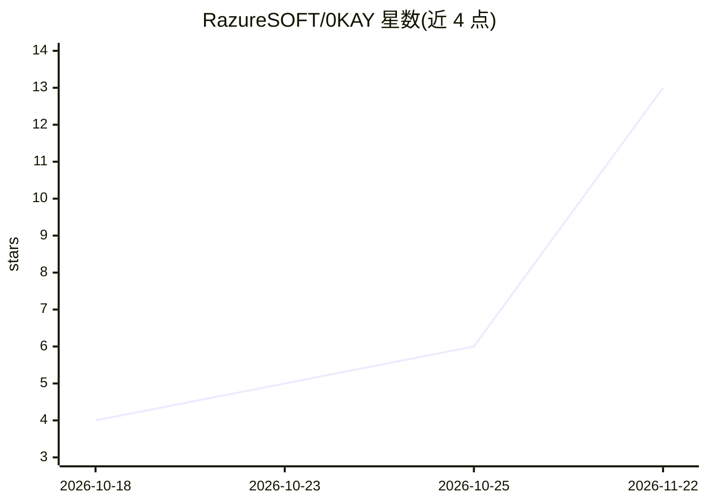

# RazureSOFT/0KAY

⭐ 13 · Python · MIT · 推送 2026-11-21 · [GitHub](https://github.com/RazureSOFT/0KAY) · 组织维护 · 中文 README

**自托管、可记事带情绪的本地 AI 伙伴平台**

本地运行的自托管 AI 伴侣平台：围绕持久状态与真实 agent 两个机制构建，包含情绪、短期/长期记忆、作息节律、关系与主动消息；同时提供文件编辑、shell、网页与桌面控制工具，风险调用需经审批门确认。模型通过用户自备的 OpenAI 兼容或 Anthropic 格式 API key 接入，数据以明文文件保存在本地。除 Go 编写的 Core 外，各能力（模型网关、persona、agent、TTS、搜索等）均为可独立安装/禁用/替换的插件，支持 WebUI 与 QQ/OneBot 接入。

## 筛选速览

| 维度 | 判定 | 备注 |
|---|---|---|
| AI 角色 | `ai-native` | 本体是模型或模型工具 |
| 许可风险 | `permissive` | MIT |
| 部署形态 | `desktop` | 安装包/桌面程序 |
| 模型依赖 | — | README 未给出锁定关系 |
| 硬件要求 | — | 无带数字的原话,不猜 |
| 安装摩擦 | `low` | 无编译、无系统依赖或容器化 |
| 成熟度 | — | 结构信号不足 |

## 能力要点

- 持久记忆、情绪、作息节律与主动消息的伴侣状态机制
- 带审批门的 agent：文件编辑、shell、网页搜索与桌面控制
- 除 Core 外全部组件均为插件，可独立安装/禁用/替换
- 默认绑定 loopback，provider 密钥仅存于 Core

## 适用场景

- 在自己电脑上跑一个会记事的 AI 伙伴
- 通过 QQ/OneBot 与 AI 伙伴对话
- 让 AI 代理代为执行文件编辑与研究任务
- 以插件方式扩展或替换 TTS、搜索、模型网关等组件

## 场景标签

`Agent 记忆` `模型网关` `语音合成` `AI 助手` · 领域:Agent 开发

## 证据(README 行号)

> L3: **A self-hosted AI companion that remembers you — with a real agent underneath.**
> L14: - **It is also a real agent.** File edits, shell, web and desktop control, behind
> L178: - **mocr** (Go) — the model gateway: provider access, streaming, retries, and

## 星数曲线

2026-10-18 4 → 2026-11-22 13（+9）

---
*卡片 v1 · prompt 1.4 · 生成 2026-11-22 · 置信度 high · 依据 README sha `2a3ecf3c8837` · [字段定义](../../DATASET.md)*
